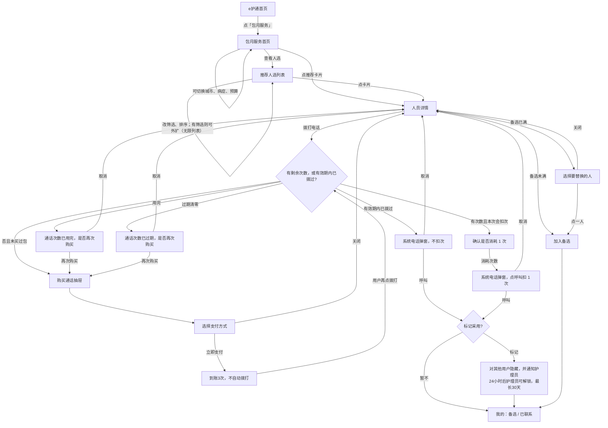

# e护通 · 包月服务 PRD

| 项 | 内容 |
|---|---|
| 产品 | e护通小程序 · 包月服务 |
| 版本 | V1.2 |
| 日期 | 2026-11-16 |
| 状态 | 与当前可交互原型 `index.html` 对齐 |
| 读者 | 产品、设计、研发、测试、算法 |

### 修订摘要

**V1.2（相对 V1.1）**

- 排序收拢到 **12.2**：列需算法的位置及各位置可能情况；规则见算法侧排序方案；旧《千人千面》冲突内容废止
- 卡片「持证」改为「健康证」；筛选项改为「是否持有健康证」（不限 / 持有）
- 详情照护能力取消页签，同屏直接展示照护经验与照护技能
- 健康证：对用户「过期 = 未持有」；**可进找人列表**，由筛选项「是否持有健康证」控制；详情不展示过期证件，按无证展示（见 9.5）
- 通话：支付成功不自动拨打；次数用完再买先提醒；购买抽屉内容读后台通话套餐配置（见 10.8）
- **多套餐购买**：见 **10.8**「规则 / 页面交互」（标题固定「购买通话」、套餐名在卡内、选中展开规则）
- 未接通可联系客服申请补偿次数；客服确认后赠送到账（见 11.1）
- 全局规则新增 **9.1.1 何时重查**：换城、改筛选、删条件、切排序、从详情返回等是否重查名单，集中约定，页面交互引用本节

**V1.1（相对 V1.0）**

- 称谓统一为「护理员」（含护理员证）
- 优选：全站去掉头像「优」角标，仅用卡片底纹区分；普通卡与优选卡尺寸一致
- 空状态分两种，见 **9.6**：同城无人（**9.6.1**，可降级上海）与全平台无人/冷启动（**9.6.2**）；与「命中为 0 走外扩」分开
- 悬浮球为「备选」+「n/3」

---

## 1. 背景

用户找包月护理员时，要自己判断病症是否对得上、价格是否可接受、要不要先联系。平台适合做信息筛选和电话接通，不适合替双方签约、收款和履约。

本期把该能力做成独立入口「包月服务」：先按病症和预算收窄，再看人、对比、付费拨打。有筛选时在命中结果下补同城未命中人选（外扩，无限列表）。对比人数控制在 3 人，满了可以直接替换。

## 2. 定位

帮用户在同城护理员里更快找到可沟通的人。

资料全部可看。电话按次付费。服务约定和履约由双方线下完成，平台不接下单。

页面固定提示：

> 选人 → 洽谈自行约定 → 线下履约 · 无需平台下单

## 3. 目标

1. 从首页一个入口进入，完成选城市、筛病症和预算、看人选、进详情。
2. 有筛选且同城仍有未命中人选时，同页给出外扩列表（与命中人数无关，无限列表）。
3. 用户能把最多 3 人放进备选对比；第 4 人可替换，不必先手动移出。
4. 无通话次数时能买包再拨打；同一护理员只在首次拨打扣次。
5. 拨打后用户可自行标记采用。采用后该护理员对其他用户隐藏，护理员可在 24 小时后解锁，未操作则最长锁定 30 天。

## 4. 用户

| 类型 | 进入时已有的信息 | 首页推荐怎么用 |
|---|---|---|
| 初次用户 | 没有历史关注病症 | 推荐附近口碑较好的认证护理员，不按病症对症 |
| 非初次用户 | 有最近关注的病症，最多记 3 个，新的在前 | 按这些病症优先推荐，并回填上次筛选 |

两类用户的筛选、列表、详情、备选、拨打规则相同。差异只在首页推荐和筛选记忆。

## 5. 范围

### 5.1 本期做

- 首页入口、城市切换（到市）
- 包月服务首页：病症、预算、推荐
- 推荐人选列表：轻筛选、排序（综合归算法，见 12.2）、外扩（无限列表，不分页）
- 人员详情
- 我的：备选、已联系
- 备选满员替换
- 通话包购买、支付、拨打计次、采用
- 采用后对其他用户隐藏该护理员，并通知护理员；护理员 24 小时后可解锁，最长锁定 30 天

### 5.2 本期不做

- 包月下单、在线签约、平台收款与结算
- 区县筛选
- 「帮我找护理员」分步引导（已不作为主路径）
- 未满 24 小时由护理员自行解锁

## 6. 名词

| 词 | 含义 |
|---|---|
| 优选（暂定） | 会员档为高阶会员的护理员。卡片底纹区分，头像不加「优」角标 |
| 参考价 | 护理员包月报价，供筛选和对比，以双方约定为准 |
| 病症 | 用户照护需求，如中风、卧床、肿瘤。可多选 |
| 备选 | 用户暂时留下对比的人，最多 3 人 |
| 已联系 | 已拨打，或已标记采用的人 |
| 采用 | 用户自己的沟通结果记录，可多人；标记后该护理员对其他用户隐藏，不代表平台签约 |
| 外扩列表 | 有筛选且同城仍有未命中人选时，在命中结果下方补出同城其他人选（与命中人数无关，无限列表） |
| 通话次数 | 购买通话包获得。同一护理员在套餐有效期内首次拨打扣 1 次；同人复拨不扣次 |
| 同城无人 | 当前市找人池 = 0，但其他城市仍有人；可降级看上海。见 **9.6.1** |
| 全平台无人 / 冷启动 | 所有城市找人池均为 0（如尚无服务人员购套餐入驻）；不换城、不挂上海。见 **9.6.2** |
| 找人池数据源 | 服务人员端已开通包月服务相应会员、可在 C 端展示的护理员 |

## 7. 信息架构

```
e护通首页
  └─ 包月服务
       ├─ 包月服务首页
       │    ├─ 病症
       │    ├─ 预算
       │    └─ 推荐列表
       ├─ 推荐人选
       │    ├─ 病症 / 价格 / 更多
       │    ├─ 综合 / 价格排序
       │    ├─ 命中结果
       │    ├─ 修改筛选
       │    └─ 外扩人选（有筛选且同城有未命中时）
       ├─ 人员详情
       │    ├─ 备选
       │    ├─ 拨打电话
       │    └─ 采用（拨打后）
       └─ 我的
            ├─ 备选
            └─ 已联系
```

全局浮层（列表和详情都可弹出）：

- 备选已满（替换）
- 通话次数已用完 / 已过期清零（再买确认）
- 消耗通话次数确认
- 系统电话弹窗（号码 / 呼叫 / 取消）
- 购买通话
- 选择支付方式

## 8. 主流程



返回：

- 详情返回进入详情前的列表或我的，并保持列表滚动位置
- 结果列表返回包月服务首页
- 包月服务首页返回 e护通首页

## 9. 全局规则

### 9.1 城市

- 精确到市。点顶部城市打开半屏「选择城市」抽屉
- 抽屉内城市均可选择，不做演示范围限制
- 切换城市后，只看该市人选；提示「已切换至{城市}」（居中 toast，见 14）；是否重查名单见 **9.1.1**
- 结果列表、外扩始终受当前城市约束
- 首页推荐、结果页在同城护理员数为 0 时，按 **9.6.1** 降级展示上海列表；全平台无人走 **9.6.2**；顶部城市不自动改回上海
- 不提供区县筛选

### 9.1.1 何时重查

换城、改筛选、删条件、切排序等是否重新拉人选，以本表为准。各页交互写「重查」时，均指按本表执行；硬筛选见 **12.1**，名单先后见 **12.2**。

| 何时 | 重不重查 | 说明 |
|---|---|---|
| 切换城市 | **重查** | 用**新城市** + **当前已生效的筛选项**。首页推荐、推荐人选命中区、外扩都按新城市出人。换城本身不算「有筛选」、不单独触发外扩出现条件（外扩仍见 10.4） |
| 首页改病症 / 预算，未点「查看人选」 | **不重查**推荐名单 | 只改上方展示与草稿回填；下方推荐名单不变 |
| 首页点「查看人选」 | **查一次** | 带上当前病症、预算进入推荐人选，列表滚到顶部 |
| 首页点「重置」（病症 + 预算） | **不重查**推荐名单 | 清空上方病症和预算，留在首页并滚到顶部；下方推荐仍按「未点查看人选」规则，不因本次重置立刻换人 |
| 推荐人选里改病症 / 预算 / 更多，点「确定」或「查看人选」 | **重查** | 命中区与外扩一起按新条件出人，列表滚到顶部 |
| 推荐人选点条件标签 ×、点「重置」 | **重查** | 去掉该条件或清空结果筛选后重查，列表滚到顶部；筛选清空后不再外扩（见 10.4） |
| 点「综合」/「价格」排序 | **不换人** | 同一批人只改顺序；切回「综合」时恢复综合序（含外扩侧与综合相关的规则）。列表滚到顶部 |
| 从详情返回列表 / 首页 / 我的 | **不强制重查** | 回到进入详情前的页面，恢复原滚动位置。若该人已不可联（如下架、被他人锁定），再操作时提示「该护理员暂不可联系」即可 |

说明：

- 换城是一次重查，不是只改顶部城市文案。
- 首页上方筛选与推荐名单解耦：换城会刷新首页推荐；改病症 / 预算在未点「查看人选」前不刷新推荐。
- 「我的」备选 / 已联系不走找人重查；从「我的」点「去选人」回到找人页后，按落地页当前条件展示（见 10.6）。

### 9.2 优选

- 优选不在头像上打「优」角标，也不在姓名旁出「优选」标签
- 统一用卡片底纹区分：浅绿渐变、点状底纹、左侧色条，右侧半透明竖排「优选」水印（属底纹一部分，不是角标）
- 普通卡与优选卡内边距、边框占位一致，仅底纹不同，避免优选卡看起来更高/更大
- 适用范围：首页推荐、推荐人选、外扩、备选、已联系、替换抽屉、详情头图
- 外扩区优选底纹视觉减弱
- 列表综合顺序见 **12.2**（由算法给出），产品不在此另定排序式

### 9.3 价格展示

列表、首页推荐、备选、替换抽屉统一为右侧三行：

```
¥8800
/月
参考价
```

详情头图为：`¥8800 / 月`，旁注「参考价格，以双方约定为准」。

预算滑杆从 ¥0 拉到右端「不限」，步进 ¥500。滑杆上方居中显示当前区间，随拖动变化：两端都在尽头为「不限」；只拉高上限为「8000元以下」；只拉高下限为「10000元以上」；两端都拉开为「4000-6000元」。右端停在「不限」时不设上限，更高报价也算在范围内；左端停在 ¥0 且右端为「不限」时，视为不限参考价。

购买通话不展示划线价。

### 9.4 病症经验标签（列表高亮）

列表、首页推荐、备选、替换抽屉卡片上展示的是**病症经验标签**（由护理员关联病症映射出的照护经验文案，如「脑卒中照护」），**不是**筛选项里的病症原文，也不是详情里的照护技能列表。

| 规则 | 说明 |
|---|---|
| 条数 | 每张卡片最多 2 个 |
| 来源 | 护理员病症 → 经验映射表（与详情「照护经验」同源） |
| 高亮 | 经验标签与**当前用于对比的偏好病症**所映射出的经验有交集则高亮 |
| 推荐人选列表 | 偏好 = 当前已选病症（筛选） |
| 非初次首页推荐 | 偏好 = 历史关注病症（不跟首页上方未点「查看人选」的筛选） |
| 初次首页推荐 | 展示经验标签，**不高亮** |
| 排序 | 命中的经验标签靠前展示 |
| 备选 / 替换 | 同样展示经验标签；不展示地区 |

用户筛病症时的选项（病症原文，用于筛选与记忆，一般不直接印在列表卡上）：

- 行动不便/中风/帕金森
- 老年痴呆
- 骨科/骨折术后
- 长期卧床
- 使用轮椅
- 大小便失禁
- 癌症／肿瘤

筛选项过长时可缩短展示，例如「行动不便/中风/帕金森」展示为「中风/帕金森」。

### 9.5 健康证规则（对用户）

对找人用户只区分两种：**持有（有效）** 与 **未持有**。  
**健康证已过期，对用户等价于未持有**，C 端不单独教「过期」概念。过期是供给 / 核验侧状态；护理员端或运营后台如需催更新，可另显「已过期」，不在本 PRD 找人流程展开。

| 判定 | 含义 |
|---|---|
| 持有 | 已上传且在有效期内、平台核验通过 |
| 未持有 | 未上传，或已过期，或核验未通过 |

| 场景 | 规则 |
|---|---|
| 找人列表 | **持有 / 未持有均可进入**首页推荐、推荐人选、外扩。无健康证不是一刀切准入项 |
| 筛选「是否持有健康证」 | 只有「不限」「持有」。不限：不限制。持有：仅有效。没有「未持有」筛选项 |
| 姓名旁标签 | 仅「持有」展示「健康证」。未持有（含过期）不出标签 |
| 详情 · 认证信息 | **持有**：展示已认证、有效期、核验说明，可点查看证件。**未持有（含过期）**：按「未上传 / 暂无健康证明材料」展示；**不展示过期证、有效期，不提供查看过期证件** |
| 已联系 / 备选再进详情 | 若证在拨打后过期，详情同样按未持有展示，不单独解释过期 |

### 9.6 空状态（先分清两种）

找人列表出现「没人」时，先判属于哪一种，**不要混用文案和降级**：

| 类型 | 判断 | 详规 |
|---|---|---|
| **同城无人** | 当前市护理员池 = 0，但其他城市（如上海）仍有人 | **9.6.1** |
| **全平台无人 / 冷启动** | **所有城市**护理员池均为 0（如尚无服务人员购套餐入驻） | **9.6.2** |

判定顺序：先看是否全平台为 0 → 是则走 **9.6.2**；否则若仅当前市为 0 → 走 **9.6.1**。  
另：同城有人、仅筛选命中为 0 → **不走 9.6**，走外扩 **10.4**。

#### 9.6.1 同城无人（空城降级）

先判断当前市护理员池是否为 0，与筛选是否过严无关。他城仍有供给时可降级看上海。

| | 处理 |
|---|---|
| 判断 | 当前市护理员数 = 0，且不满足 9.6.2（全平台并非全空） |
| 不做什么 | 不展示「改条件就能出人」；结果页不展示修改筛选色块、条件标签、外扩 |
| 空态文案 | 「当前城市暂无护理员，可换个城市看看」 |
| 降级列表 | 大拇指 +「可以先看看上海的护理员」+ 上海护理员列表 |
| 排序 | 需算法，见 **12.2** |
| 顶部城市 | 仍为用户所选，不偷偷改回上海 |
| 卡片城市 | 写「上海」，与补句一致 |
| 当前城已是上海且无人 | 只出空态，不再挂上海列表（若此时他城也无人，应改判 **9.6.2**） |
| 点卡片 | 进详情 |
| 点「查看人选」 | 仍按顶部当前城市查询（结果页走本节样式） |

产品侧选上海是因为护理员人数最多，界面不写这一点。

首页额外：不展示「附近可约护理员 / 为您推荐」标题与副说明。

#### 9.6.2 全平台无人 / 冷启动

找人池在**所有城市**均为 0。按冷启动表达，不写成故障，也**不要**引导换城或挂上海列表。

| | 处理 |
|---|---|
| 判断 | 全平台可展示护理员数 = 0 |
| 首页推荐区 | 不展示「附近可约 / 为您推荐」标题与副说明；不展示上海降级 |
| 主文 | **包月找人即将在本地区开放** |
| 辅文 | **护理员入驻开通中，开通后可在这里筛选、对比并电话沟通** |
| 筛选区 | 仍可先选病症 / 预算；有已选时提示「已记下你的病症/预算，开通后可按此优先看人」；未选时不额外提示 |
| 次要按钮 | 「看看其他服务」→ 回 e护通首页（或其他服务入口）；不引导「去选人」进空列表 |
| 推荐人选列表 | 点「查看人选」后：同一套冷启动空态；无修改筛选色块、无外扩、无上海列表；换城仍为空 |
| 我的 · 备选 / 已联系 | **无人选**（尚未入驻则不可能有备选/已联系记录）；页签人数与备选角标均为 0；同一套冷启动空态与「看看其他服务」，不展示历史演示卡 |
| 外扩 / 空城上海 | **不出现** |
| 禁止文案 | 「可换个城市看看」「系统繁忙」「暂无护理员可约」等（本态不用） |

原型：顶栏 persona「模拟空状态」切换本态。

### 9.7 回顶按钮

下列可纵向长列表的页面提供「回到顶部」悬浮按钮。

| 项 | 说明 |
|---|---|
| 出现页面 | 包月服务首页（下方推荐区可滚时）、推荐人选列表（含命中 / 外扩 / 空城上海列表）、人员详情、**我的 · 已联系**（名单较长时可回顶） |
| 可不出现 | **我的 · 备选**（最多 3 人，一般无需回顶）；未滚过阈值高度时各页均不展示 |
| 展示条件 | 当前页主滚动区向下滚动超过约一屏后出现；回到顶部附近后隐藏 |
| 位置 | 右下角悬浮；在「备选」悬浮球上方（有球的页面）；详情须避开拨打底栏与备选球 |
| 点击 | 当前页主滚动区平滑滚回顶部；不切换页面、不清除筛选 / 已联系筛选项 |
| 形态 | 圆形浅底按钮，含向上箭头与「顶部」文案（实现可微调视觉，交互不变） |

首页与推荐人选共用列表容器时，回顶作用于**当前可见**的滚动区域（首页为首页推荐区，结果页为列表区）。

说明：正式环境「我的 · 已联系」须支持回顶；**本期交互原型可不演示该入口的回顶**（名单短时也不强求展示），以本 PRD 为准验收研发。

## 10. 页面说明

浮层通用交互：点右上角关闭，或点遮罩空白处，关闭浮层。未点确认的内容不生效。后打开的浮层盖在先打开的上面。

### 10.1 入口

e护通首页服务入口文案为「包月服务」。金刚位中该入口有轻量动效（图标轻跳、外圈波纹、文案略加重色），便于用户一眼看到；点按后动效暂停。系统开启减少动态时可不播动效。

| 操作 | 结果 |
|---|---|
| 点「包月服务」 | 进入包月服务首页。非初次用户回填上次筛选 |

### 10.2 包月服务首页

标题：包月服务。右上角为当前城市。顶部流程条使用第 2 节文案。

筛选区标题：想找什么样的护理员？

| 项 | 未选 | 已选 |
|---|---|---|
| 病症 | 请选择病症 | 已选病症，多项用顿号连接 |
| 预算 | 不限参考价 | 如 ¥6000–¥8000 |

预算预设档：6000 以下、6000–8000、8000–10000、10000–12000、10000 以上、不限。病症、预算都可以不选，不选表示该条件不限。非初次用户进入时回填上次病症和预算。

筛选区下方是推荐。未点「查看人选」前，改病症或预算不改变推荐名单。

首页推荐文案与展示：

| 场景 | 标题 | 说明 | 列表 | 经验标签高亮 | 排序 |
|---|---|---|---|---|---|
| 初次 | 附近可约护理员 | 附近口碑较好的认证护理员，可先了解再沟通 | 同城全量，无限列表 | 无（只展示、不高亮） | 冷启见下方；没有历史病症，经验和技能按本人条数 |
| 非初次 · 有历史关注病症 | 为您推荐 | 根据你关注的{病症1}、{病症2}…优先推荐（最多 3 个，新在前） | 同城全量，无限列表 | 命中历史关注病症所映射经验的标签高亮，见 9.4 | 冷启见下方；经验和技能按历史关注病症的相关命中个数 |
| 非初次 · 无历史关注病症 | 为您推荐 | 根据你的历史关注优先推荐 | 同城全量，无限列表 | 无（只展示、不高亮） | 冷启见下方；经验和技能按本人条数 |
| 同城无人（初次 / 非初次均同） | 不展示 | 不展示说明；只出空态「当前城市暂无护理员，可换个城市看看」+ 大拇指「可以先看看上海的护理员」+ 上海列表（见 **9.6.1**） | 上海全量，无限列表 | — | 与首页推荐同一套冷启顺序，池子换成上海 |

**首页推荐列表里有谁**  
当前城市里全部可展示、且没有被锁定的人。未点「查看人选」前，页面上方正在改的病症、预算不从这份名单里删人，也不改变这份名单的顺序。首页没有「价格」排序，也不用预算上下浮动 20%。

**首页推荐 · 综合（冷启）**  
只排上面这份名单。先按是否优选分成两组：优选整组在前，非优选整组在后。所有优选都排在所有非优选前面。组内再按下面顺序比。某一项已经能分出谁在前，就按这项排定；只有这一项相同，才比较下一项：

1. 持有有效健康证的人在前。过期、没上传、核验没通过，都算没有有效健康证。
2. 照护经验多的人在前。
3. 经验数量相同，照护技能多的人在前。
4. 从业年限长的人在前。
5. 开通包月服务早的人在前。没有开通时间的，排在有开通时间的人后面。
6. 仍相同的，按护理员编号从小到大排，保证每次查询顺序不变。

第 2、3 项怎么数：有历史关注病症时，按这些病症映射出的相关照护经验、相关照护技能命中了几个。没有历史关注病症（含初次用户）时，按本人一共填了几条照护经验、几条照护技能。有历史病症时，先把记住的用户情况映射成需要的经验和技能，再和护理员自己勾的经验、技能按标签比对，一个标签只计 1 次。上方草稿里刚选、还没点「查看人选」的病症，不拿来数这一项。

**首页同城无人后的上海列表**  
不是外扩。上海全部可展示、且没有被锁定的人。不按当前筛选删人。没有价格排序，也不用预算上下浮动 20%。全平台一个人都没有时，不挂这份上海列表。

只排这份上海名单。先按是否优选分成两组：优选整组在前，非优选整组在后。所有优选都排在所有非优选前面。组内再按下面顺序比。某一项已经能分出谁在前，就按这项排定；只有这一项相同，才比较下一项：

1. 持有有效健康证的人在前。过期、没上传、核验没通过，都算没有有效健康证。
2. 照护经验多的人在前。
3. 经验数量相同，照护技能多的人在前。
4. 从业年限长的人在前。
5. 开通包月服务早的人在前。没有开通时间的，排在有开通时间的人后面。
6. 仍相同的，按护理员编号从小到大排，保证每次查询顺序不变。

第 2、3 项怎么数：有历史关注病症时，按这些病症映射出的相关照护经验、相关照护技能命中了几个。没有历史关注病症（含初次用户）时，按本人一共填了几条照护经验、几条照护技能。有历史病症时，先把记住的用户情况映射成需要的经验和技能，再和护理员自己勾的经验、技能按标签比对，一个标签只计 1 次。上方草稿里刚选、还没点「查看人选」的病症，不拿来数这一项。

推荐卡片：头像（无优选角标）、姓名、健康证标签、最多 2 个病症经验标签（规则见 9.4）、性别 · 年龄 · 从业年限 · 城市、右侧价格；优选仅靠卡片底纹区分，与普通卡尺寸一致。

交互：

| 操作 | 结果 |
|---|---|
| 点标题左侧返回首页 | 回到 e护通首页 |
| 点城市 | 打开半屏「选择城市」抽屉，内容与 App 选城页一致：搜索、当前城市、热门城市、字母列表与右侧索引。点任一城市立即切换，提示「已切换至{城市}」并关闭；点关闭不切换。列表内城市均可选。切换后重查见 **9.1.1** |
| 点「病症」 | 打开「选择病症」。可多选；再点已选项取消；点「不限」清空。点「确定」写回首页并关闭（未点「查看人选」前不重查推荐名单，见 **9.1.1**）。点关闭则放弃本次勾选 |
| 点「预算」 | 打开「包月预算」。拖动或点预设只改草稿。点「重置」草稿回到 ¥0–不限。点「确定」写回首页并关闭（未点「查看人选」前不重查推荐名单，见 **9.1.1**）。点关闭则放弃草稿 |
| 点「重置」 | 清空病症和预算，留在首页，页面回到顶部；推荐名单是否换人见 **9.1.1** |
| 点「查看人选」 | 进入推荐人选列表（按当前条件查一次，见 **9.1.1**），列表滚到顶部 |
| 点推荐卡片 | 进入该人员详情，并记下首页滚动位置 |

### 10.3 推荐人选列表

从首页点「查看人选」进入。顶栏标题仍为「包月服务」（不改为「推荐人选」）。筛选收成吸顶条。

| 入口 | 内容 |
|---|---|
| 病症 | 可多选，选项同首页；交互同首页，打开「选择病症」半屏抽屉 |
| 预算 | 参考价区间，预设档同首页；打开预算半屏抽屉 |
| 更多 | 性别（不限、女、男）、年龄（不限、25–35、36–45、46–55、55 以上）、是否持有健康证（不限、持有）、身高（不限、155 以下、155–165、165–175、175 以上） |

排序吸顶。命中列表和外扩列表分开排，不合成一条队列。切「综合 / 价格」时两边都不换人，只改各自内部顺序（见 **9.1.1**）。外扩排序见 **10.4**。

**命中列表里有谁**  
一项筛选都没有时，命中列表就是当前城市里全部可展示、且没有被锁定的人。病症、预算、性别、年龄、健康证、身高都不删人，也不出外扩。有筛选时，命中列表只留通过当前硬筛选的人；没通过的同城人进外扩（见 **10.4**）。

**命中列表 · 综合（冷启）**  
只排上面这份命中列表。先按是否优选分成两组：优选整组在前，非优选整组在后。组内再按下面顺序比，某一项已能分出先后就停，相同才比下一项：

1. 持有有效健康证的人在前。过期、没上传、核验没通过，都算没有有效健康证。
2. 照护经验多的人在前。
3. 经验数量相同，照护技能多的人在前。
4. 从业年限长的人在前。
5. 开通包月服务早的人在前。没有开通时间的，排在有开通时间的人后面。
6. 仍相同的，按护理员编号从小到大排。

第 2、3 项怎么数：当前选了病症，按相关照护经验、相关照护技能的命中个数；没选病症，按本人填写的经验条数、技能条数。有病症时，先把所选用户情况映射成需要的经验和技能，再和护理员自己勾的经验、技能按标签比对，一个标签只计 1 次。命中列表**不用**预算上下浮动 20%。

**命中列表 · 价格**  
同一批人，只按参考价重排。第一次从高到低，再点从低到高。参考价相同的，保持刚才综合顺序。

命中区为**无限列表**（不分页、不展示页码）。已选条件展示为可删除标签，另有重置。结果页顶部不展示「符合条件 N 人」。

列表卡片：头像（无优选角标）、姓名、健康证标签、病症经验标签最多 2 个（命中当前筛选病症所映射经验则高亮，见 9.4）、性别 · 年龄 · 从业年限 · 城市、右侧价格；优选靠卡片底纹。命中区和外扩区卡片都能点。

同城无人与「有人但没命中」要分开：

| 情况 | 处理 |
|---|---|
| 当前城市护理员数为 0 | 见 **9.6.1**（若全平台无人见 **9.6.2**）。列表用推荐人选卡片样式展示上海列表；顶部筛选项可留，但不引导改条件。排序见下方「结果页同城无人后的上海列表」 |
| 同城有人、命中为 0 | 走 10.4：修改筛选色块 + 可外扩 |

**结果页同城无人后的上海列表**  
不是外扩。上海全部可展示、且没有被锁定的人。不按当前筛选删人。不用预算上下浮动 20%。全平台一个人都没有时，不挂这份上海列表。

只排这份上海名单。先按是否优选分成两组：优选整组在前，非优选整组在后。所有优选都排在所有非优选前面。组内再按下面顺序比。某一项已经能分出谁在前，就按这项排定；只有这一项相同，才比较下一项：

1. 持有有效健康证的人在前。过期、没上传、核验没通过，都算没有有效健康证。
2. 照护经验多的人在前。
3. 经验数量相同，照护技能多的人在前。
4. 从业年限长的人在前。
5. 开通包月服务早的人在前。没有开通时间的，排在有开通时间的人后面。
6. 仍相同的，按护理员编号从小到大排，保证每次查询顺序不变。

第 2、3 项怎么数：当前已经选了病症，按相关照护经验、相关照护技能的命中个数；没选病症，按本人一共填了几条照护经验、几条照护技能。有病症时，先把所选用户情况映射成需要的经验和技能，再和护理员自己勾的经验、技能按标签比对，一个标签只计 1 次。这里按结果页当前已选病症来数，不按首页历史关注病症来数。

右下角悬浮球两行：上「备选」、下「n/3」（n 为当前备选）。备选大于 0 时按钮加深。点进仍是「我的」，默认落在上次页签（首次为备选）。不把已联系人数加进角标。**详情页同样展示该悬浮球**（位置抬高，避开底栏）；进入「我的」后不显示。

交互：

| 操作 | 结果 |
|---|---|
| 点返回 | 回到包月服务首页，保留刚用过的筛选 |
| 点城市 | 同首页选城；切换后重查见 **9.1.1** |
| 点「病症」 | 打开「选择病症」半屏抽屉（同首页）：可多选，再点取消；点「不限」清空；点「确定」写回并立即重查（见 **9.1.1**），列表滚到顶部；点关闭则放弃本次勾选 |
| 点「预算」 | 打开预算半屏抽屉。拖动和预设只改草稿。点「确定」立即重查（见 **9.1.1**），列表滚到顶部。点关闭则放弃草稿 |
| 点「更多」 | 打开更多筛选，四项均为单选。点「重置」这四项回到不限。点「查看人选」关闭浮层、重查（见 **9.1.1**），列表滚到顶部。未点「查看人选」就关闭，列表保持原样 |
| 点「综合」 | 切到综合排序（不换人，见 **9.1.1**），列表滚到顶部。已经是综合时再点无变化 |
| 点「价格」排序 | 第一次切到价格排序；再点在从高到低、从低到高之间切换（不换人，见 **9.1.1**）。每次列表滚到顶部 |
| 点条件标签的 × | 去掉该条件，立即重查（见 **9.1.1**），列表滚到顶部 |
| 点「重置」 | 清空全部结果筛选，立即重查（见 **9.1.1**） |
| 点人员卡片 | 进入详情，并记下当前列表滚动位置 |
| 点悬浮球「备选」 | 进入我的，落在上次所在页签；第一次为备选 |
| 拖动悬浮球 | 按钮跟着移动，松手吸到左或右边缘，不进入我的 |

### 10.4 外扩

外扩出现在推荐人选列表里，不是「我的」。同时满足：**至少有一项筛选**（病症、价格、性别、年龄、健康证、身高；换城本身不算）；**同城还有未进入命中结果的人**。与命中人数无关——命中再多也出外扩。同城护理员池为 0 时不走外扩，见 **9.6.1 / 9.6.2**、10.3。

人选池与命中列表分开：同城、且**不在命中结果中**的人（不要求满足病症 / 预算 / 更多等硬条件）。外扩区为**无限列表**，不截断为「补满一页」。

**外扩列表里有谁**  
一项筛选都没有时，没有外扩名单。至少选了一项筛选（病症、预算、性别、年龄、健康证、身高），并且当前城市里还有可展示、未锁定、又没有进入命中列表的人，这些人才进入外扩列表。他们不要求满足病症、预算、更多筛选。外扩列表和命中列表分开排，不合成一条队列。

**外扩列表 · 综合（冷启）**  
只排上面这份外扩名单。

先按是否优选分成两大组：优选整组在前，非优选整组在后。所有优选都排在所有非优选前面。

当前选了预算时，每个大组内部再按参考价分成两小组：参考价落在「预算上下浮动 20%」里的人整组在前，落在外面的人整组在后。没选预算，或预算选的是不限，不做这一步。浮动范围：

| 所选预算 | 外扩里优先的参考价 |
|---|---|
| 有上下限，如 6000–8000 | 下限 × 0.8 到上限 × 1.2，即 4800–9600 |
| 只有上限，如 6000 以下 | 不超过上限 × 1.2，即不超过 7200 |
| 只有下限，如 10000 以上 | 不低于下限 × 0.8，即不低于 8000 |
| 不限 | 不使用这一步 |

每个小组内部再按下面顺序比。某一项已经能分出谁在前，就按这项排定；只有这一项相同，才比较下一项：

1. 持有有效健康证的人在前。过期、没上传、核验没通过，都算没有有效健康证。
2. 照护经验多的人在前。
3. 经验数量相同，照护技能多的人在前。
4. 从业年限长的人在前。
5. 开通包月服务早的人在前。没有开通时间的，排在有开通时间的人后面。
6. 仍相同的，按护理员编号从小到大排，保证每次查询顺序不变。

第 2、3 项怎么数：当前选了病症，按相关照护经验、相关照护技能的命中个数；没选病症，按本人填写的经验条数、技能条数。有病症时，先把所选用户情况映射成需要的经验和技能，再和护理员自己勾的经验、技能按标签比对，一个标签只计 1 次。这两个数量只排外扩名单里的先后，不能把对不上的人送回命中列表。

例如预算选了 6000–8000。同一个优选大组里，报价 5500、9000 的人整组排在报价 4000、12000 的人前面。5500 和 9000 之间，从有效健康证、照护经验、照护技能、从业年限、开通时间，比到护理员编号。

**外扩列表 · 价格**  
外扩名单里的人不换，仍是刚才那一批，只在这份名单里改按参考价排。第一次点「价格」，参考价高的在前；再点一次，参考价低的在前。方向和命中列表用同一个开关。参考价相同的人，保持刚才综合排序里的先后。这时不再把「预算上下浮动 20%」单独提前，也不再按优选整组提前。再点「综合」，外扩名单恢复优选分组；选了预算时，再恢复浮动 20% 的小组。小组内重新按：有效健康证、照护经验、照护技能、从业年限、开通时间、护理员编号。选了病症按相关命中个数，没选按本人条数。

页面结构：

1. 命中卡片区，淡青绿底（命中全量，无限列表）
2. 修改筛选色块，冷灰底
3. 外扩区，灰底（外扩全量，无限列表）

修改筛选色块：命中大于 0 时标题为「以上是符合条件的人员」；等于 0 时为「暂无符合条件的人员」。副文案「修改可以重新查询」。右侧「重置」，下方是当前条件标签。

外扩标题：

> 实心大拇指图标 + 以下是不完全满足{条件1}、{条件2}的其它人选

条件用当前筛选标签。没有可展示条件时，用「当前筛选」。外扩卡片字段与命中卡片相同，优选底纹保留但视觉减弱。同城有人且命中为 0 时展示修改筛选色块和外扩区；命中 ≥1 且满足外扩条件时同样展示；同城无人时不走外扩，见 10.3。

交互：

| 操作 | 结果 |
|---|---|
| 点外扩卡片 | 同命中卡片，进入详情并记下滚动位置 |
| 点条件标签 × | 去掉该条件，命中区和外扩区一起重查（见 **9.1.1**），列表滚到顶部 |
| 点「重置」 | 清空全部结果筛选后重查（见 **9.1.1**）。筛选清空后不再外扩 |

### 10.5 人员详情

标题：人员详情。

头图：头像（无优选角标）；优选时头图区域用与列表一致的底纹；城市在右上角，只显示市；姓名、健康证标签、联系状态；价格 `¥金额 / 月`；说明「参考价格，以双方约定为准」。

| 状态 | 标签 |
|---|---|
| 未拨打且未采用 | 不展示 |
| 已拨打、未采用 | 已拨打 |
| 已采用 | 已采用 |

基本信息四宫格：性别、年龄、从业年限、身高。自我介绍展示文字，有介绍视频才展示视频入口。

照护能力同屏直接展示，不做页签：先「照护经验」（由病症映射，命中当前筛选的高亮并排在前面），再「照护技能」（默认 6 条，超过则显示「展开全部（N）」）。

认证信息：学历、语言能力、健康证（规则见 9.5：仅有效时展示已认证与有效期；过期或未上传均按无证展示）、其他资质。证书信息含水印：仅供护理员服务签约参考，禁止他用。

服务与责任说明（页底）：

> 平台仅提供护理员信息展示与电话沟通，不参与包月签约、收款与履约。用户标记「采用」不代表与平台签约，亦不代表平台对后续服务结果负责。

底栏三个按钮：备选、采用、拨打电话。采用仅已拨打后出现。底栏提示只留一处：未拨打为「首次拨打扣 1 次 · 未接通可再拨 · 号码拨打后展示」；已拨打为「可再次拨打，不扣次 · 未接通可再拨」。

交互：

| 操作 | 结果 |
|---|---|
| 点返回 | 回到进入详情前的页面（首页推荐、推荐人选或我的），并恢复原来的滚动位置；不强制重查，见 **9.1.1** |
| 点「展开全部 / 收起」 | 展开或收起照护技能 |
| 点健康证或资质证书 | 仅有效健康证或有明细的资质可打开证书信息。无证 / 过期无「查看」。无明细的资质打开认证说明 |
| 点介绍视频 | 播放视频 |
| 点「备选」 | 未满：加入，按钮变为「已备选」，提示「已加入备选」。已满：打开「备选已满」，按钮仍是「备选」 |
| 点「已备选」 | 移出备选，按钮回到「备选」，提示「已移出备选」 |
| 点「采用」 | 未采用时标记并锁定该护理员。已采用时取消采用，立即解锁。未拨打时这个按钮不出现 |
| 点「拨打电话」 | 见 10.8 |
| 点悬浮球「备选」 | 进入我的（同列表页悬浮球）；可拖动，松手吸边 |
| 拖动悬浮球 | 同列表：跟着移动，松手吸到左或右边缘，不进入我的 |

### 10.6 我的

从推荐人选、包月服务首页或**人员详情**的悬浮球进入。进入「我的」后不显示悬浮球。

| 页签 | 数据 |
|---|---|
| 备选 n/3 | 当前备选。顺序为加入顺序，替换后新人留在原位置 |
| 已联系 n | 曾拨打过的人，以及已采用的人（**不因拨打满 90 天而退出列表**）。90 天只影响再拨是否扣次，见 11。排序：按最近拨打时间从近到远；无拨打、仅采用的按采用时间，排在后面 |

状态标签（与 10.5 同口径）：**未拨打且未采用不展示**（不要「未联系」）；有记录时标「已拨打」或「已采用」（已采用优先）；**不因满 90 天改成别的标签或从列表拿掉**。失效人选另标「暂不可联系」。

已联系可筛：全部、已拨打、已采用。备选卡片与替换抽屉一致：头像（无优选角标）、姓名、有则展示状态标签、病症经验标签、右侧价格；优选靠卡片底纹。不展示地区。

失效人选（下架 / 不存在等）：备选、已联系、备选已满替换抽屉内卡片均置灰，并展示「暂不可联系」（见 10.7 / 15）。

已联系清**失效**记录（正常可联卡片无删除入口）：

1. **卡片垃圾桶**：仅「暂不可联系」置灰卡，在卡片视觉中心叠一个垃圾桶 icon。已联系：点 icon 删除该条已联系记录，若此人仍在备选，备选不受影响，不走「取消采用」。备选：点 icon 移出备选并腾席。正常可联卡不出现垃圾桶。
2. **清理失效**：当列表中存在带「暂不可联系」的置灰人选时，已联系顶栏出现「清理失效」；一点清除当前列表内全部失效人选，正常可联记录不动。无失效人选时不展示该入口。同样不逐条走取消采用。

空状态（文案按场景区分，**不要混用**）：

| 场景 | 出现条件 | 文案 / 按钮 |
|---|---|---|
| **普通空 · 备选** | 找人池有人，但用户备选为 0 | 还没有备选。去列表挑最多 3 位，方便对比后再拨打。按钮「**去选人**」→ 回找人页 |
| **普通空 · 已联系（全部）** | 找人池有人，用户尚无拨打/采用记录 | 暂无已联系记录。拨打或标记采用后将显示于此。按钮「**去选人**」 |
| **普通空 · 已联系（已拨打/已采用筛）** | 有已联系池，但当前筛无命中 | 按筛选项说明暂无对应记录。按钮「**去选人**」 |
| **冷启动空 · 备选 / 已联系（含筛选）** | 全平台无人（**9.6.2**） | 与找人同一套冷启动：主文「包月找人即将在本地区开放」+ 辅文开通说明；按钮「**看看其他服务**」→ 回 e护通分类页（或约定入口）。页签人数与备选角标均为 **0**，不展示人选卡，不用「去选人」 |

说明：冷启动时尚无入驻，用户不可能已有备选/已联系；与「有人可约但自己还没选/没打过」的普通空，文案和按钮都不同。

交互：

| 操作 | 结果 |
|---|---|
| 点返回 | 回到进入我的之前的包月服务首页或推荐人选 |
| 点「备选 / 已联系」 | 切换页签，数量跟着当前数据 |
| 点「全部 / 已拨打 / 已采用」 | 只过滤已联系列表 |
| 点「移出备选」 | 立即移出，名额 -1，提示「已移出备选」。空了显示空状态。失效卡上该按钮不可点，改由卡片中心垃圾桶移出 |
| 点「详情」（可联） | 进入详情。从详情返回仍回到我的 |
| 点「拨打电话」或「再拨打」（可联） | 同 10.8。**留在当前「我的」页**，不跳详情；购买 / 再买提醒 / 拨打提示 /「沟通得如何？」均在本页浮层或 toast。无次数先购买 |
| 点「采用」（可联） | 标记并锁定该护理员，规则同 10.8 |
| 点「取消采用」（可联） | 取消标记，并立即解锁，该护理员重新出现在其他用户列表 |
| **备选 · 失效卡** | 整卡置灰，展示「暂不可联系」；**移出备选 / 详情 / 拨打电话都不可点**；卡片中心叠垃圾桶，点垃圾桶移出备选并腾席 |
| **已联系 · 失效卡** | 整卡置灰，展示「暂不可联系」；**详情 / 再拨打 / 采用 / 取消采用不可点**；卡片中心叠垃圾桶（见下） |
| 点已联系失效卡上的垃圾桶 | 删除该条已联系记录；居中 toast「已删除」；不取消采用；若此人仍在备选，备选不受影响 |
| 点「清理失效」 | 仅已联系顶栏、且当前列表存在失效人选时出现。一点清掉当前已联系里全部置灰失效人选；居中 toast「已清理失效人选」；清完后入口消失；不逐条取消采用；正常可联记录不动 |
| 空状态点「去选人」 | 离开我的，回到找人页 |

### 10.7 备选已满

备选已有 3 人，又对第 4 人点「备选」时弹出。不直接写入备选。抽屉是全局浮层，人在详情或列表都能看见。

标题「备选已满」。说明「选择要替换掉的人选（最多 3 人）」。列表为当前 3 人，卡片同备选列表。底部提示：将加入「姓名」· ¥金额/月 参考价。

列表中若有下架 / 不存在等失效人选：与备选一致，**置灰 + 文案「暂不可联系」**；仍可点选进行替换（便于清掉失效席位）。

交互：

| 操作 | 结果 |
|---|---|
| 点其中一人（含置灰失效人选） | 立即替换，关闭浮层，提示「已替换备选」。新人留在被替换人的位置 |
| 点关闭或遮罩 | 关闭，3 人不变，第 4 人不加入 |

加入未满员时提示「已加入备选」。详情里已备选再点是移出，不走「已在备选」提示。

### 10.8 购买通话与支付

点拨打时先判断次数。同时满足下面两点才进入购买：① **账户剩余通话次数 = 0**（含过期清零）；② **该护理员不在同人免扣次有效期内**（同人免扣次与次数过期均取后台套餐「有效期范围」，见 11）。有剩余次数且本次会扣次时，先确认是否消耗 1 次，确认后再出系统电话弹窗，点「呼叫」才扣次。对该人仍在免扣次有效期内，不确认消耗，直接出电话弹窗，呼叫不扣次。支付成功后不自动拨打，用户需再点拨打。  
**在哪点拨打，流程就在哪**：详情底栏、我的 · 备选、我的 · 已联系，均不因拨打/购买/「沟通得如何？」跳转到其他页。

首购与再买共用同一购买抽屉。拉取**当前可售、适用于护理员、在可购买时间内**的次数包列表；下单带选中 `package_id`。无可用套餐则不打开抽屉，提示暂不可购买。

#### 规则

| 项 | 口径 |
|---|---|
| 半屏标题 | 固定「**购买通话**」（1 个 / 多套餐都一样） |
| 套餐名称 | 内容区 / 卡内主标题，如「电话沟通包」；**不当**半屏标题 |
| 列表顺序 | **加入倒序**（后上架在前）；**无「推荐」标签**；默认勾选第 1 个 |
| 1 个可售 | 名称 + 大价格 + 权益（每项小 icon）+ 规则全文（跟在权益下） |
| ≥2 个可售 | 单选列表；每卡：名称、价格、权益（每项小 icon）；**仅选中卡**在权益下展开该包规则全文；未选中不露规则 |
| 卡上露出的后台信息 | 名称、价格、权益规则（排序 + icon + 短文案）、规则说明（选中展开）、次数/有效期（优先走权益；权益未配则补「N 次拨打」「{有效期}有效」） |
| 不展示 | 划线价、「限时沟通权益」角标、服务人员类型、套餐类型、可购买时间（后三者只做过滤）；不做列表外公共规则区 |
| 协议 | 「确认支付」上方：勾选「已阅读并同意《通话服务协议》」；默认未勾；打开抽屉重置未勾 |
| 支付方式层 | 不重复套餐摘要；微信支付、金币支付（展示余额）；不做代付；提示发票联系客服；「立即支付」 |
| 到账 | 支付成功只到账、**不自动拨打**；提示「支付成功，已到账 {N} 次通话，请再次点击拨打」 |
| 采用弹层 | 拨打完成后约 0.7s，未采用则在当前页出「沟通得如何？」；已采用不再弹 |

#### 页面交互

| 操作 | 结果 |
|---|---|
| 有次数，且本次会扣次 | 先出底部抽屉「消耗通话次数」：主文「是否确定消耗 1 次通话，拨打「姓名」？」；下方「通话次数当前剩余：N次」（N 高亮）。点「确定」后出系统电话弹窗；点「呼叫」扣 1 次并开始拨打；点「我再想想」或关闭不扣次、不拨打 |
| 该人仍在同人免扣次有效期内 | 不确认消耗，直接出系统电话弹窗。点「呼叫」不扣次 |
| 无次数且未买过包 | 打开「购买通话」抽屉 |
| 无次数且次数是用完的 | 先「通话次数已用完」→「再次购买」再打开同一购买抽屉；取消则关闭 |
| 无次数且剩余次数已过期清零 | 先「通话次数已过期」：剩余通话次数已到期清零，是否再次购买。确认后打开同一购买抽屉；取消则关闭 |
| 打开购买抽屉 | 按加入倒序展示；默认勾选第 1；协议未勾；选中卡展开其规则 |
| 点某一套餐卡（多套餐） | 切换选中；确认支付金额同步；原卡收起规则、新卡展开；协议勾选不重置 |
| 点《通话服务协议》 | 打开协议页 |
| 未勾选协议点「确认支付」 | toast 提示先同意；不进支付方式 |
| 已勾选点「确认支付 ¥{price}」 | 打开「选择支付方式」（金额=当前选中套餐） |
| 点支付方式 | 只切换选中，不扣款 |
| 点「立即支付」 | 关购买/支付层；次数 +N（选中套餐）；到账提示；不自动拨打 |
| 点关闭 / 遮罩 | 只关当前层；次数不变、不拨打 |
| 点「标记采用」 | 写入采用并锁定，关浮层；该人从其他用户找人列表消失并通知护理员 |
| 点「暂不」或关闭采用层 | 不标记；toast：可稍后在详情或「我的 · 已联系」中标记 |

### 10.8a 通话包订单入口（口径）

**不放**包月服务首页 / 推荐人选 / 包月「我的」底部。通话包订单只进小程序「**我的订单**」（见 **10.9**）。无次数拨打仍走 10.8 购买；扣次仅已支付单、按有效期更近优先（FIFO）。

### 10.9 通话包订单（列表 / 详情）

进小程序「我的订单」，与上门单同入口、分类型。**只展示通话包有的字段；没有的不展示。**

原型演示：顶栏 Tab「**模拟购买通话记录订单**」→ 按现网订单列表/详情样式，预置三种状态单（已支付 / 待支付 / 已取消）。

#### 规则

| 项 | 口径 |
|---|---|
| 状态 | **已支付 / 待支付 / 已取消**（与 10.8a 一致） |
| 商品图 | 默认图（通话包通用图） |
| 名称 | 套餐名称（如「畅聊沟通包」） |
| 列表顶栏 | 与现网订单列表一致：绿色顶栏「搜索订单」+ 服务日历入口 + 状态 Tab（全部 / 待支付 / 待预约 / 待服务 / 服务中 / 待评价） |
| 列表数据 | 通话包三种状态单都放在「**全部**」；「待支付」可筛待支付单；待预约/待服务/服务中无通话包数据 |
| 列表卡 | 订单号、右上状态、默认图、套餐名、按次、x1、需付款/实付款、操作；**不放**有效期/待支付说明/已取消中间提示条 |
| 列表操作 | 待支付：联系客服 + **「mm:ss 继续付款」**；已支付 / 已取消：仅联系客服（不放查看详情，点整卡进详情） |
| 待支付详情 | 顶栏倒计时文案；商品卡（图/名/按次/价/x1/需付款）；订单编号、下单时间；底栏联系客服 + 继续付款（无取消订单） |
| 已取消详情 | 顶栏「已取消」；商品卡（图/名/按次/价/x1/需付款）；订单编号、下单时间；底栏仅联系客服；**无**服务地址/被护理人/情况描述 |
| 已支付详情 | 状态与剩余/有效期；商品卡；费用；支付方式、**购买次数**、剩余次数、有效期至。**购买次数**为本单支付时购得的次数，固定不变；**剩余次数**随拨打扣次减少，也可因客服补偿赠送增加（见 11.1） |
| **不展示** | 取消订单、服务日历、上门地址/人员/被护理人、耗材、上门费、去预约、再来一单等 |

#### 页面交互

| 操作 | 结果 |
|---|---|
| 点订单卡 | 进该单详情（已支付也不单独放「查看详情」按钮） |
| 待支付「继续付款」 | 打开支付方式；成功 → 已支付并到账 |
| 倒计时归零 | 待支付 → 已取消 |
| 联系客服 | 进客服会话 |
| 复制订单号 | 复制成功提示 |

退款走客服核实；用户侧不自助直接退款到账。

## 11. 通话与采用规则

| 规则 | 说明 |
|---|---|
| 新购次数 | 每次支付成功 +N；N 取所购通话套餐配置（后台「可联系人数」按次数口径，见 10.8） |
| 扣次 | 对该护理员在「同人免扣次」有效期内第一次拨打扣 1 次 |
| 复拨 | 有效期内再次拨打同一人不扣次 |
| 拨打记录过期（仅计次） | 对该人超过免扣次有效期未再拨：再拨按首次拨打重新扣 1 次，**不单独弹提示**；无次数则走购买 / 再买。**已联系列表与「已拨打」标签仍保留**，不自动退出 |
| 同人免扣次有效期 | 默认与历史口径一致为 90 天；若后台另有统一配置则从其配置。与套餐「剩余次数过期」不是同一件事 |
| 通话包次数过期 | 自到账起，满套餐配置的有效期仍未用完的剩余次数**作废**（清零）；需再买才能拨。已购标记仍保留，用于区分首购 / 再买提醒 |
| 次数不足 | 首购直接购买抽屉；曾买过则先提醒再买。支付成功只到账，须再点拨打才拨出 |
| 未接通 | 不另扣次。同人可再拨。本期**不单独做「未接通结果页/结果提示」**；引导见开始拨打 toast 与购买说明（**11.1**） |
| 客服补偿次数 | 用户不可自助加次；客服确认后由后台赠送 N 次，**挂到当前未过期的已支付通话包订单上**，该单剩余次数 +N，规则见 **11.1** |
| 号码 | 拨打前不在详情明文展示；拨打动作发生时使用完整号码 |
| 采用前提 | 当前处于已拨打有效期内；未拨打时详情不出现「采用」按钮，产品上无「未拨打就采用」路径 |
| 采用人数 | 同一用户可同时标记多位护理员 |
| 对其他用户 | 锁定期间不出现在他人的首页推荐、推荐人选和外扩中 |
| 对采用者 | 仍可在详情、备选、已联系中看到 |
| 通知护理员 | 采用成功后立即发消息。消息说明已被采用、24 小时后可解锁、未操作最长锁 30 天 |
| 护理员解锁 | 采用满 24 小时后，护理员可自行解锁。未满 24 小时不能解锁 |
| 自动解锁 | 采用者和护理员都未操作时，从采用时刻起满 30 天自动解锁 |
| 解锁后（护理员解锁或满 30 天） | 该护理员**立即**重新出现在其他用户的找人列表。采用者侧：**采用标记仍在**，已联系仍保留，除非用户主动取消采用 |
| 用户取消采用 | 立即解锁，该护理员重新出现在其他用户列表；采用者侧采用态清除 |

拨打后弹出「沟通得如何？」：

- 标题：沟通得如何？
- 主文：如果沟通合适，可将「姓名」标记为采用。
- 说明：采用后，该护理员将不对其他用户展示，并会收到通知。可同时标记多位，之后也可补标记。
- 暂不 / 关闭抽屉（×、遮罩）：关闭，不标记、不锁定，同一句 toast（见 14）
- 标记采用：写入已采用，并开始锁定

已采用后再进入拨打完成，不再重复弹出。

锁定从采用成功时刻起算。提前结束只有两种：采用者取消采用，或护理员在满 24 小时后自行解锁。两种都没有时，第 30 天自动结束。结束后该护理员恢复出现在其他用户列表。

### 11.1 未接通与客服补偿次数

**场景：** 用户已消耗的通话次数中，有一次或多次一直打不通时，可联系客服申请补偿；**须客服确认完毕后再赠送** 1 次或多次。用户侧**不能自助加次数**。

与现有扣次关系：

- 同一人首次已扣次、未接通：仍可**免费再拨**（不另扣次），补偿不是替代再拨。
- 补偿针对客服认定应返还的已消耗次数（如多人各扣了首次却一直未通等），以客服审核为准。

**用户侧交互：**

| 步骤 | 说明 |
|---|---|
| 入口 | ① **开始拨打**居中 toast：「正在拨打 {号码}。未接通可稍后再拨或联系客服。」（拨打发起时提示，不是未接通后再弹一层）；点「联系客服」走小程序客服会话 / 客服页（实现可做成 toast 内可点，或用户自行从客服入口进入）。② **购买通话**说明：多次未接通可联系客服，确认后补偿通话次数。本期不做「未接通结果态」、不做独立「申请补偿」表单 |
| 申请 | 用户在客服会话说明情况；前端**不加次**，仅等待客服处理 |
| 到账 | 客服在后台赠送 N 次后：**挂到当前未过期的已支付通话包订单**，该单**剩余次数 +N**；账户可拨打剩余次数随之增加。**购买次数不变**。只增加剩余、不自动拨打，不跳详情 |
| 若当时正开着「次数已用完 / 已过期」 | 关闭该提醒（或刷新后按最新剩余次数），允许用户继续点拨打 |

**客服 / 后台（产品结果，不规定坐席系统）：**

- 赠送必须挂在**当前仍未过期的已支付通话包订单**上：该单「剩余次数」+N；「购买次数」仍为下单购得的次数，不因赠送改写。
- 有多笔未过期已支付单时，挂到与扣次一致的那一笔（有效期更近、当前用于扣次的订单）。
- 若没有未过期已支付单，本期不支持挂单赠送；需用户先有有效订单后再补，或由运营另案处理。
- 记录赠送原因（如未接通补偿）、次数 N、挂靠订单号、操作人、时间；与购买区分便于对账。不改已联系、已拨打标签、同人免扣次规则。

**次数与过期：** 补偿次数并入所挂订单的剩余次数，与该单共用同一有效期；该单到期时，含补偿在内的剩余一并清零。账户可拨打剩余 = 各未过期已支付单剩余次数之和。

**到账通知（在端 toast + 系统通知 + 短信）：**

| 时机 | 形式 | 文案 |
|---|---|---|
| 赠送成功且用户仍在小程序内 | 居中 toast | 客服已为你补偿到账 {N} 次通话 |
| 每次赠送成功（无论是否在端） | 系统通知（站内信） | 标题「包月服务/赠送通话次数到账」；正文同短信口径。**点击跳转包月服务首页** |
| 每次赠送成功（无论是否在端） | 短信 | 客服已为你补偿到账 {N} 次通话，可返回 e护通「包月服务」继续拨打 |

说明：在端以 toast 即时反馈；系统通知与短信保证离开当前页/离开小程序也能收到。不发订阅消息作主通道；不做再进页弱提示。不强制弹窗挡操作，不自动拨出。用户再进该订单详情时，应看到剩余次数已增加。

## 12. 筛选与排序规则

### 12.1 筛选硬条件（产品 / 业务）

硬条件：不符合的人不进入命中结果。由业务与客户端约定；**不是**算法打分项。

| 条件 | 命中规则 |
|---|---|
| 城市 | 必须是当前市 |
| 锁定 | 被其他用户采用且仍在锁定期内的护理员，不进入推荐、结果列表和外扩 |
| 病症 | 未选则不限。已选则护理员病症与所选有交集，多选为或关系 |
| 价格 | 参考价落在区间内。不限则不限制 |
| 性别、年龄、是否持有健康证、身高 | 选了才限制。健康证只有「不限」「持有」；选「持有」时仅有效证进入，过期按未持有滤掉。未选时有证无证都可进列表 |

外扩人员只要求同城，不要求满足上述其他条件，且不能与命中结果重复。

非初次用户在结果页改筛选后，记住本次病症、预算及其他筛选，下次进首页回填。首页重置只清病症和预算。

### 12.2 排序（哪些位置需要算法）

下列位置的名单顺序由算法给出；**每种情况用哪套规则、怎么算**，见算法侧排序方案（旧《千人千面》冲突内容废止）。本表只把「这个位置会出现哪些情况」列清，供研发对照。

| 位置 | 说明 | 可能情况 |
|---|---|---|
| 包月服务首页 · 推荐列表 | 同城全量无限列表；初次/非初次仅文案与高亮不同 | ① 无行为　② 有过行为 |
| 包月服务首页 · 空城降级上海列表 | 同城无人时，上海全量无限列表顺序 | ① 无行为　② 有过行为（池子为上海；不走筛选项） |
| 推荐人选列表 · 综合 | 默认及点「综合」；命中区无限列表；含进列表后再改筛选 | ① **筛选项**：勾了病和/或预算（只选病 / 只选预算 / 两者都有）　② **有过行为**：未勾病·预算，但有点筛、看详情等（含只改性别、年龄、健康证、身高等）　③ **无行为**：未勾病·预算，且无有效行为信号（含条件都不限）。人是否进池见 12.1 |
| 推荐人选列表 · 空城降级上海列表 | 同城无人进结果页时的上海全量无限列表 | ① 无行为　② 有过行为（同首页空城；不按本次筛选硬过滤） |
| 外扩区补人（当前为综合） | 外扩全量无限列表先后；交互见 10.4 | 有筛选且同城有未命中时展示；顺序按算法侧兜底约定，不与主列表混比分 |

**不需要算法：** 价格排序及价格下外扩；备选 / 已联系 / 替换抽屉；详情。冷启阶段首页推荐、命中列表、外扩列表不走上表，分别见 **10.2**、**10.3**、**10.4**。

说明：初次 / 非初次只管文案与高亮，不等于无行为 / 有过行为；无健康证可进列表，由筛选项控制（见 9.5）。

## 13. 状态

### 13.1 用户侧

| 状态 | 存储 | 影响 |
|---|---|---|
| 当前城市 | 会话，非初次可记忆 | 人选范围 |
| 筛选条件 | 非初次记忆 | 首页回填、结果查询 |
| 备选名单 | 最多 3 个 id | 我的、替换 |
| 通话剩余次数 | 账户 | 能否直接拨打 |
| 拨打记录 | 护理员 id + 时间 | 已联系收录、号码状态；距今 ≤90 天则再拨免扣次 |
| 采用记录 | 护理员 id、采用时间 | 详情和已联系展示；计算 24 小时与 30 天 |
| 锁定状态 | 锁定中 / 已解锁，及解锁原因、解锁时间 | 控制是否出现在其他用户列表 |

### 13.2 护理员侧展示字段

姓名、头像、性别、年龄、身高、从业年限、城市、病症、参考价、是否优选、健康证是否有效（及有效期，供 9.5 判定）、学历、语言、自我介绍、介绍视频、其他资质证书。

备选次数、采用次数等热度相关数据 C 端卡片不展示。

## 14. 反馈文案

形式约定：

| 形式 | 说明 |
|---|---|
| 居中 toast | 屏幕中央短暂提示，自动消失；本功能内 toast **一律居中** |
| 页内文案 | 嵌在页面里的固定文案，不是浮层 |

| 场景 | 形式 | 文案 |
|---|---|---|
| 加入备选 | 居中 toast | 已加入备选 |
| 重复备选 | 居中 toast | 已在备选 |
| 移出备选 | 居中 toast | 已移出备选 |
| 替换成功 | 居中 toast | 已替换备选 |
| 切换城市 | 居中 toast | 已切换至{城市} |
| 支付成功 | 居中 toast | 支付成功，已到账 {N} 次通话，请再次点击拨打（N 为本单购买次数） |
| 客服补偿到账（在端） | 居中 toast | 客服已为你补偿到账 {N} 次通话 |
| 客服补偿到账（系统通知） | 系统通知 | 标题「包月服务/赠送通话次数到账」；点进包月服务首页 |
| 客服补偿到账（短信） | 短信 | 客服已为你补偿到账 {N} 次通话，可返回 e护通「包月服务」继续拨打 |
| 开始拨打 | 居中 toast | 正在拨打 {号码}。未接通可稍后再拨或联系客服。 |
| 采用成功 | 居中 toast | 已标记采用。该护理员已对其他用户隐藏，护理员将收到通知 |
| 取消采用 | 居中 toast | 已取消采用 |
| 点「暂不」（未标记） | 居中 toast | 可稍后在详情或「我的 · 已联系」中标记采用 |
| 关闭采用抽屉（未标记） | 居中 toast | 同上（点 × 或点遮罩关闭） |
| 人员不可联系 | 居中 toast | 该护理员暂不可联系 |
| 已联系点失效卡垃圾桶 | 居中 toast | 已删除 |
| 清理失效 | 居中 toast | 已清理失效人选 |
| 同城无人 · 空态（9.6.1） | 页内文案 | 当前城市暂无护理员，可换个城市看看 |
| 同城无人 · 降级引导（9.6.1） | 页内文案 | 可以先看看上海的护理员（前加实心大拇指） |
| 全平台无人 · 主文（9.6.2） | 页内文案 | 包月找人即将在本地区开放 |
| 全平台无人 · 辅文（9.6.2） | 页内文案 | 护理员入驻开通中，开通后可在这里筛选、对比并电话沟通 |
| 全平台无人 · 按钮（9.6.2） | 页内按钮 | 看看其他服务 |
| 外扩 · 修改筛选色块（命中 > 0） | 页内文案 | 以上是符合条件的人员；副文案「修改可以重新查询」；右侧「重置」 |
| 外扩 · 修改筛选色块（命中 = 0） | 页内文案 | 暂无符合条件的人员；副文案同上；右侧「重置」 |
| 外扩 · 外扩区标题 | 页内文案 | 实心大拇指 +「以下是不完全满足{条件1}、{条件2}的其它人选」；无可展示条件时用「当前筛选」（见 10.4） |

## 15. 异常与边界

| 情况 | 处理 |
|---|---|
| 健康证已过期 | 对用户按未持有：仍可进找人列表；姓名无「健康证」标签；详情按无证展示，不展示过期证。筛「持有」时被滤掉。见 9.5 |
| 健康证未上传 / 核验未通过 | 同未持有，见 9.5 |
| 城市下没有人（首页推荐） | 先按 9.6 区分：同城无人 **9.6.1** / 全平台无人 **9.6.2** |
| 城市下没有人（推荐人选列表） | 同上；并见 10.3 |
| 有筛选但命中为 0，同城仍有人 | 走修改筛选色块与外扩，不使用空城样式 |
| 有筛选、同城没有未命中其他人 | 只展示命中结果和修改筛选，不展示外扩区 |
| 护理员下架或不存在 | **首页推荐、推荐人选、外扩**：不进入列表。**备选 / 已联系 / 备选已满替换抽屉**：卡片仍在（备选仍占席），整卡置灰；姓名旁或原状态标签位置展示固定文案「暂不可联系」（不区分下架 / 注销等细因）。备选与已联系上详情 / 拨打 / 再拨打 / 采用 / 移出备选等按钮都不可点；备选失效卡与已联系一样，卡片中心叠垃圾桶，点垃圾桶移出备选。已联系失效卡垃圾桶删除该条已联系，或顶栏「清理失效」批量清（见 10.6）。**替换抽屉**内失效人选同样置灰 +「暂不可联系」，仍可点选替换（见 10.7） |
| 支付抽屉关闭 | 次数不变，不拨打 |
| 替换抽屉关闭 | 备选不变 |
| 金币余额不足 | 本期原型不拦截。正式环境支付失败时停留在支付方式页并说明原因，不增加次数 |
| 同一人重复扣次 | 不允许。以 90 天拨打记录判断 |
| 护理员处于他人采用锁定中 | 不进入当前用户的推荐、结果列表和外扩。已打开的旧页面再操作时，提示该护理员暂不可联系 |
| 护理员未满 24 小时点解锁 | 不解锁，并说明需满 24 小时 |
| 锁定满 30 天 / 护理员已解锁 | 立即对其他用户恢复曝光；采用者侧采用标记与已联系**仍保留**，除非用户取消采用（见 11） |
| 拨打满 90 天（无论是否采用） | 已联系仍显示，标签不变；再点拨打时静默按首次重新扣 1 次（无额外提示），无次数则走购买 / 再买 |
| 通话包剩余次数到期未用完 | 剩余次数作废清零；再拨需购买。曾买过包的标记保留。再买提醒用「通话次数已过期」，不用「已用完」 |
| 未接通申请补偿 | 用户不可自助加次；走客服确认后赠送。见 11.1。赠送挂未过期订单、剩余次数增加；不自动拨打 |
| 客服赠送时用户正在再买提醒上 | 关闭或刷新再买提醒；按最新剩余次数可继续点拨打 |
| 客服赠送时无未过期已支付单 | 本期不挂单赠送；需先有有效订单。见 11.1 |
| 未登录点拨打 / 备选 | 先走登录；登录成功后回到触发前的页面（详情 / 我的 / 列表等），再继续原操作或需用户再点一次（实现可选：自动续办或仅回页） |

## 16. 平台边界

平台负责：

- 护理员资料展示与证书核验结果展示
- 城市、病症、价格及其他筛选（硬条件见 12.1）
- 推荐列表、外扩的产品交互与空城降级展示
- 综合 / 默认推荐排序对接算法（位置见 12.2）；价格排序由列表侧按参考价重排
- 备选与已联系
- 通话次数售卖和拨打计次；通话包订单列表/详情（见 10.9）
- 采用记录，以及采用后的列表隐藏、护理员通知、24 小时解锁和 30 天自动解锁

平台不负责：

- 包月签约订单、合同、定金和尾款（通话包订单除外，见 10.9）
- 上门档期
- 服务过程中的纠纷裁决
- 把「采用」写成平台签约。采用只隐藏列表并通知护理员，不生成签约订单

## 17. 验收清单

### 入口与首页

1. 首页入口文案是「包月服务」，可进入该流程。
2. 城市只有市，切换后人选范围跟着变。
2a. 何时重查符合 **9.1.1**：换城重查并带当前筛选；首页未点「查看人选」前改病症/预算不刷新推荐；结果页确认筛选 / 删条件 / 重置会重查；切综合/价格不换人；从详情返回不强制重查。
3. 病症可多选，预算可设区间，重置只清这两项。
4. 不选病症、不选预算也可以查看人选。
5. 初次、非初次的推荐标题、说明符合 10.2；同城/上海推荐为无限列表；推荐顺序对接算法（位置见 12.2）。
5a. 同城无人符合 **9.6.1**：无推荐标题与副说明；空态句与上海降级文案正确；顶部城市不变；点「查看人选」仍查当前城。
5b. 全平台无人 / 冷启动符合 **9.6.2**：主文「即将在本地区开放」、辅文开通说明；可预填筛选提示；有「看看其他服务」；无上海降级、无外扩；与 9.6.1 文案区分。
6. 改了首页筛选但还没点查看人选时，下方推荐不跟着变（与 **9.1.1** 一致）。
6a. 界面称谓均为「护理员」，无「护工」。

### 列表与外扩

7. 进入结果页后标题仍为「包月服务」，筛选为病症、预算、更多。
7a. 同城无人进结果页符合 **9.6.1**：无改条件色块、无外扩；空态 + 上海列表；换城后按新城市重查。全平台无人见 **9.6.2**。
8. 冷启排序：命中列表与外扩列表分开排。命中列表先优选/非优选，组内再比健康证、经验、技能、年限、开通时间、编号，不用预算 ±20%。外扩列表在优选分组后，选了预算再按 ±20% 分小组，小组内比较项与命中列表相同。价格排序两边都不换人，只改参考价升降。
8a. 12.2 所列需算法位置均已对接；备选/已联系/替换/详情不走推荐排序。
9. 推荐人选 / 首页推荐 / 空城上海 / 外扩均为无限列表，不分页、无页码。
10. 有筛选且同城仍有未命中人选时，无论命中多少都展示外扩区（全量）；标题和色块区分正确。
11. 同城有人且命中为 0 时有「暂无符合条件的人员」、可删除条件、重置和外扩。
12. 条件标签点 × 后立即重查。
13. 结果页不出现「符合条件 N 人」。
13a. 首页推荐 / 推荐人选 / 详情 / 我的·已联系有回顶，符合 9.7；备选可不做。原型可只演示前三处，已联系回顶以研发为准。

### 详情、备选、我的

14. 详情头图无头像优选角标；优选时头图有底纹；含右上角城市、四宫格、价格和参考价说明。
14a. 任一列表/详情中，优选与普通卡尺寸一致，仅底纹不同。
15. 照护能力同屏展示经验与技能（无页签）；经验命中高亮；技能超过 6 条可展开。姓名旁仅有效健康证展示「健康证」标签。
15a. 健康证规则符合 9.5：过期=未持有；有证无证默认可进列表；筛选项只有「不限 / 持有」，选「持有」只留有效证；详情不展示过期证、按无证展示。
16. 备选未满能加入；已在备选有提示；满员后详情和列表都能弹出替换。
17. 替换后仍是 3 人；关闭抽屉不替换。
18. 备选列表和替换抽屉都没有地区，都有病症经验标签、优选底纹（无头像角标）和统一价格格式。
19. 悬浮球为「备选」+「n/3」，出现在首页推荐 / 推荐人选与详情；进入我的后隐藏。页签内备选 / 已联系各自显示自己的数量。
20. 已联系可按全部、已拨打、已采用筛选。

### 通话与采用

21. 无次数且未买过包：直接购买通话。曾买过且次数用完：先「次数已用完」。曾买过且剩余次数过期清零：先「次数已过期」。确认后再进同一购买抽屉。有次数且会扣次：先确认消耗，再出电话弹窗，点「呼叫」才扣次。免扣次复拨直接出电话弹窗。
21a. 包月「我的」**不放**通话包购买记录；订单只在小程序「我的订单」（见 10.8a / 10.9）。
22. 购买抽屉符合 10.8「规则 / 页面交互」：标题「购买通话」、套餐名在卡内、加入倒序默认第 1、权益带 icon、规则选中展开、协议勾选、支付成功不自动拨打。
23. 支付成功加 N 次（套餐配置），**不自动拨打**；须再点拨打才拨出。
23a. 未接通可联系客服申请补偿；用户不可自助加次；客服确认后赠送 N 次并挂到当前未过期已支付订单，该单剩余次数 +N、购买次数不变；通知为在端 toast + 系统通知（点进包月首页）+ 短信（见 11.1 / 14）；不自动拨打。
24. 同一护理员 90 天内只扣 1 次。
25. 未拨打时无采用入口；同一用户可同时采用多人。
26. 采用后该护理员立即从其他用户的找人列表消失，并收到消息。
27. 护理员未满 24 小时不能解锁；满 24 小时后可自行解锁。
28. 双方都不操作时，锁定在第 30 天自动结束。用户取消采用则立即解锁。
29. 详情底栏提示与拨打状态一致，且只出现一处。详情和采用确认里都能看到隐藏列表、24 小时解锁、最长 30 天。
29a. 通话包进入「我的订单」；列表/详情符合 10.9：状态已支付/待支付/已取消；待支付可去支付；无上门地址等。
29b. 详情主按钮「去找人拨打」；可复制订单号、联系客服、发起退款走客服。

## 18. 数据需求（研发对照）

| 数据 | 用途 |
|---|---|
| 用户最近关注病症，最多 3 个 | 非初次首页推荐和标签高亮 |
| 用户是否有历史订单或关注 | 区分初次 / 非初次 |
| 上次筛选 | 非初次回填 |
| 护理员会员档 | 优选展示（底纹） |
| 护理员病症、证书、城市、参考价、年限、身高、性别、年龄 | 筛选、卡片、详情 |
| 用户备选列表 | 最多 3 |
| 通话剩余次数、是否买过通话包 | 拨打门槛；再买提醒 |
| 通话包订单（单号、状态、套餐、**购买次数**、剩余次数、有效期、实付、支付方式、待支付截止） | 小程序「我的订单」（10.9）。购买次数固定；剩余次数可因拨打减少、因客服补偿增加 |
| 客服补偿赠送记录（次数 N、挂靠订单号、原因、操作人、时间） | 与购买区分；挂未过期订单；11.1 对账与通知 |
| 护理员维度的拨打时间 | 已联系；≤90 天免扣次 |
| 用户维度的采用标记及采用时间 | 详情、已联系、24 小时与 30 天计算 |
| 护理员锁定状态、解锁方、解锁时间 | 其他用户列表是否展示；护理员端解锁按钮是否可用 |
| 护理员消息 | 采用成功时通知：已被采用、24 小时后可解锁、最长 30 天 |

热度等排序输入由算法侧使用，C 端不展示。
