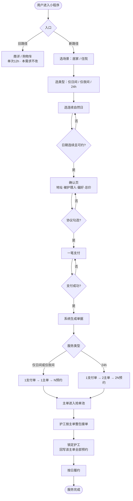
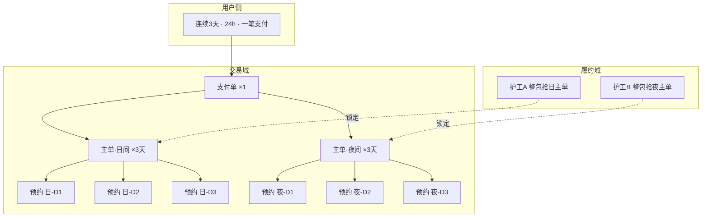
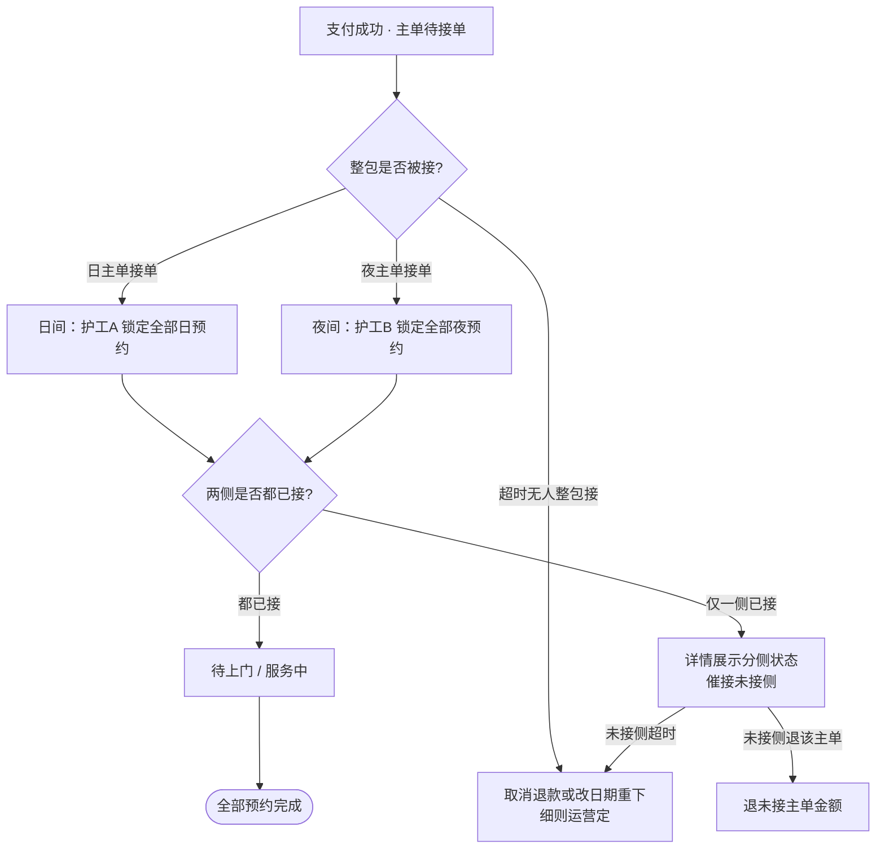

# PRD：快速帮助用户找到服务（连续陪护快下单）

| 属性 | 内容 |
|------|------|
| 需求编号 | R-261022-019 |
| 需求名称 | 快速帮助用户找到服务 |
| 文档版本 | V1.0 |
| 状态 | 方案已冻结（待评审） |
| 产品 | e护通小程序（陪护/到家服务） |
| 业务目标 | 让需要连续陪护的人快速下单 |

---

## 1. 背景与问题

### 1.1 现状痛点

1. **24 小时需拆单**：用户要下「白班 12h + 夜班 12h」两单，并分别预约，认知成本高、操作不便。
2. **连续多天更碎且易换人**：除白夜拆单外，还需多次下单/加数量；**现状抢单按「单次班次」粒度**，数量=3（如 3 个日间）可被最多 **3 个不同人**各抢 1 天，不保证同一人做满；24h 多天则白夜分别下、多人更散。
3. **难找服务**：进入小程序后，用户不易直接找到「连续多日 / 24h」所需服务组合（需自行组合日间/夜间 SKU）。

### 1.2 现有能力摘要

- 平台已有四类核心 SKU：
  - 居家日间 12 小时看护
  - 居家夜间 12 小时看护
  - 住院日间 12 小时陪护
  - 住院夜间 12 小时陪护
- 下单入口：商详「去下单 / 加购」、服务卡片「立即预约」、购物车结算。
- 下单页支持「先买后约 / 立即预约」；服务按 12h 班次售卖；可选数量、性别、人员等级等。
- **抢单现状**：按单次班次/数量拆抢，多天可被多人接（例如日间数量=3 → 可 3 人各做 1 天），**不是**「3 夜+3 白天只由 2 人接」。

### 1.3 目标态一句话

用**最少问题**帮助用户完成「连续自然日的日间 / 夜间 / 24h」下单：只选日期、付一笔钱；系统生成支付单与班次主单；**一主单一人整包**。例：数量语义为连续 3 天 24h（**3 夜 + 3 白天**）时，**只能被 2 个人抢**——1 人包全部日间、1 人包全部夜间。

---

## 2. 目标与成功标准

### 2.1 业务目标

让需要连续陪护（含院内、居家）的用户快速下单，降低拆单、多次预约、换人带来的成本。

### 2.2 成功标准（建议量化）

| 指标 | 方向 |
|------|------|
| 连续 ≥2 天且选 24h 的用户下单步数 / 耗时 | 相对现商详+购物车路径下降 |
| 日主单 / 夜主单「一人履约全部日期」占比 | 上升 |
| 「如何约满 24h / 如何保证同人」类客服咨询 | 下降 |
| 单次仅 12h 路径的转化与客诉 | 不恶化 |

---

## 3. 范围

### 3.1 做（MVP）

- 首页浮球（或其他入口）进入「连续陪护」问卷快下单。
- 问卷：场景 → 服务类型 → 连续日期 → 确认（地址/被护理人/偏好）→ **一笔支付**。
- 系统按规则生成：**1 支付单 → 1～2 主单 → 按日预约单**。
- 改抢单/派单粒度：**按主单整包接单**，禁止按日拆抢。
- 连续多日路径 **仅支持立即预约**。
- 保留现有商详 / 加购 / 购物车单次路径，服务「只买一次 12h」。

### 3.2 不做（本迭代）

- 护工端「可见排班页」（原 BRD 待定项，单独立项）。
- 用户修改服务钟点；隔日挑选（非连续自然日）。
- 连续多日的「先买后约」。
- 强制日间与夜间为同一人。
- 全站搜索/分类重构（「难找服务」本需求用问卷入口绕过找 SKU）。
- 改造全部旧商详与购物车逻辑。

### 3.3 用户与场景

| 项 | 说明 |
|----|------|
| 目标用户 | 需要连续陪护的下单人（本人或代他人） |
| 场景 | 居家、住院均可 |
| 服务类型 | 仅日间 12h / 仅夜间 12h / 24h（日+夜） |

---

## 4. 业务规则（已冻结）

### 4.1 日期与时间

| 规则 | 说明 |
|------|------|
| 日期 | 仅支持 **连续自然日** |
| 时间 | 全国统一；各服务在平台配置默认起止时刻；**用户不可改钟点**，时间维度只能选日期 |
| 默认来源 | 用户所选服务类型对应 SKU 的配置时段 |

### 4.2 同人规则

| 规则 | 说明 |
|------|------|
| 单班次多日 | 该班次主单全部日期由 **同一人** 服务 |
| 24h | **固定 2 人**：日间 1 人 + 夜间 1 人；连续多天仍是这两人 |
| 日 ≠ 夜 | 允许日间护工与夜间护工不是同一人 |
| 目标举例 | 连续 3 天 24h = **3 白天 + 3 夜** → **仅 2 人抢**（日主单 1 人整包、夜主单 1 人整包） |
| 对比现状 | 现状按次拆抢（如日间×3 可 3 人各抢 1 天）；目标改为 **按主单整包、不可按日拆** |

### 4.3 预约与支付

| 规则 | 说明 |
|------|------|
| 预约方式 | 连续多日 **仅立即预约** |
| 支付感知 | 用户付 **一笔总价** |
| 系统单据 | 例：3 天 24h → **1 支付单 + 2 主单 + 6 预约单** |
| 改时间 | 不支持；需取消后重新下单 |

### 4.4 单据生成矩阵

| 用户选择 | 支付单 | 主单 | 预约单 |
|----------|--------|------|--------|
| 仅日间 × N 天 | 1 | 1（日间×N） | N |
| 仅夜间 × N 天 | 1 | 1（夜间×N） | N |
| 24h × N 天 | 1 | 2（日间×N + 夜间×N） | 2N |

### 4.5 SKU 映射

| 场景 | 类型 | 映射商品 |
|------|------|----------|
| 居家 | 仅日间 | 居家日间 12 小时看护 |
| 居家 | 仅夜间 | 居家夜间 12 小时看护 |
| 居家 | 24h | 上述日间 + 夜间 |
| 住院 | 仅日间 | 住院日间 12 小时陪护 |
| 住院 | 仅夜间 | 住院夜间 12 小时陪护 |
| 住院 | 24h | 上述日间 + 夜间 |

---

## 5. 用户流程

### 5.1 主流程

1. 用户从首页浮球 / 「连续陪护」入口进入（旧商详路径并行保留）。
2. 选择场景：居家 / 住院。
3. 选择服务类型：仅日间 12h / 仅夜间 12h / 24h（时段由类型默认，不再问钟点）。
4. 选择连续护理日期（开始日 + 天数或结束日）；系统校验连续与可约。
5. 确认页：地址、被护理人、性别/等级（可默认）、费用明细、同人说明；勾选协议。
6. 一笔支付 → 生成支付单 + 主单 + 预约单。
7. 主单进入抢单池；护工按主单整包接单 → 按日履约 → 完成。

### 5.2 业务流程图

#### 图 A：端到端主流程（C 端下单 → 履约）



#### 图 B：单据生成与抢单（以 24h × 3 天为例）



#### 图 C：接单与异常分支



### 5.3 异常与边界

| 场景 | 处理原则 |
|------|----------|
| 日期不连续 / 超可约范围 | 不可提交，引导修改日期 |
| 主单超时无人整包接 | 取消退款或引导改日期重下（细则运营定） |
| 24h 仅一侧主单已接 | 详情展示分侧状态；未接侧催接或按主单退（细则见退改） |
| 用户要改时间 | 明示不支持，取消后重下 |

---

## 6. 功能需求

### 6.1 入口

- 首页放置浮球或其他「连续陪护 / 快速下单」入口。
- 可选：商详增加次要入口「需要连续多天/24h？走快速下单」（不替换 12h 商品主路径）。

### 6.2 问卷（最少问题）

| 顺序 | 问题 | 必填 | 说明 |
|------|------|------|------|
| 1 | 居家 / 住院 | 是 | 决定 SKU 池 |
| 2 | 仅日间 / 仅夜间 / 24h | 是 | 决定主单数量与默认时段 |
| 3 | 连续日期 | 是 | 唯一时间输入；连续自然日 |
| 4 | 地址、被护理人 | 是 | 尽量默认历史；确认页完成亦可 |
| 5 | 性别、人员等级 | 是（可有默认） | 建议 24h 日夜共用一套偏好 |

**不再询问：** 具体钟点、分别进入哪个商详、手动组合几个 SKU。

### 6.3 确认页

**信息结构（自上而下）：**

1. 服务摘要：场景 + 类型 + 日期区间（如「住院 · 24小时陪护 · 10/24–10/26 共3天」）
2. 时段说明：展示配置默认起止；文案标明不可修改
3. 服务地址、被护理人（可编辑）
4. 性别要求、人员等级（可编辑，带默认）
5. 费用明细：日间单价×天数、夜间单价×天数、上门费等、券、应付总额
6. 同人说明：「日间全部日期由同一人服务；夜间全部日期由同一人服务」
7. 协议勾选
8. 底栏：应付总额 +「立即支付」（无先买后约）

**校验：** 地址/被护理人必填；日期连续；协议勾选；提交前校验可约库存。

### 6.4 支付与履约

- 支付成功后创建支付单、主单、预约单（事务一致）。
- 抢单对象为主单；接单成功后锁定 `caregiver_id`，并回写该主单下全部预约。
- 禁止按单日预约抢单、禁止一主单多人拆天数。

### 6.5 订单详情（用户侧）

- 以 **支付单** 为头订单，下挂 1～2 个班次主单卡片，主单下可展开按日预约列表。
- 支付单头状态与主单状态文案见 §7。

---

## 7. 状态与文案

### 7.1 支付单头状态

| 状态 | 用户文案 |
|------|----------|
| 待支付 | 待支付 |
| 已支付，存在待接主单 | 已支付，正在安排护工 |
| 24h 一侧已接一侧未接 | 日间已接单，夜间待接单（或反之） |
| 全部主单已接 | 护工已接单，待上门服务 |
| 服务中 | 服务进行中 |
| 已完成 | 已完成 |
| 已取消 | 已取消 |
| 退款中 / 已退款 | 退款中 / 已退款 |

### 7.2 主单状态文案

| 状态 | 文案 | 副文案示例 |
|------|------|------------|
| 待接单 | 待护工接单 | 需同一人服务全部 N 天 |
| 已接单 | 已接单 | 护工：xxx · 将服务 N 天日间/夜间 |
| 服务中 | 服务中 | — |
| 已完成 | 已完成 | — |
| 已取消 | 已取消 | — |

### 7.3 单日预约状态文案

待服务 / 服务中 / 已完成 / 已取消（展示日期 + 班次）。

### 7.4 异常提示

| 场景 | 提示 |
|------|------|
| 无人整包接 | 暂无人承接全部日期，可取消退款或修改日期后重新下单 |
| 仅一侧接单 | 夜间仍在安排中，日间护工已确认（示例） |
| 不可改时间 | 服务时段不可修改；如需调整请取消后重新下单 |

---

## 8. 数据模型

### 8.1 支付单 payment_order

| 字段 | 说明 |
|------|------|
| payment_id | 主键 |
| user_id | 下单用户 |
| total_amount / pay_amount | 应付 / 实付 |
| status | 待支付/已支付/已取消/退款中/已退款 |
| scene | 居家/住院 |
| service_mode | 仅日间/仅夜间/24h |
| date_start / date_end / day_count | 连续日期与天数 |
| address_snapshot / care_recipient_snapshot | 快照 |
| gender_req / staff_level | 偏好 |
| book_type | 固定 immediate |
| created_at / paid_at | 时间 |

### 8.2 主单 master_order

| 字段 | 说明 |
|------|------|
| master_order_id | 主键 |
| payment_id | 所属支付单 |
| shift_type | 日间/夜间 |
| sku_id | 映射四类 12h 商品之一 |
| unit_price / day_count / amount | 价格与天数 |
| status | 待接单/已接单/服务中/已完成/已取消 |
| caregiver_id | 整包护工（未接为空） |
| grab_mode | 固定 whole_package |
| default_time_start / end | 配置时段，只读 |

### 8.3 预约单 appointment

| 字段 | 说明 |
|------|------|
| appointment_id | 主键 |
| master_order_id / payment_id | 归属 |
| service_date / shift_type | 服务日与班次 |
| time_start / time_end | 默认时段，用户不可改 |
| status | 待服务/服务中/已完成/已取消 |
| caregiver_id | 与主单锁定人一致 |
| seq | 第几天 1…N |

**约束：** 同一主单下全部预约的 caregiver_id 必须相同。

### 8.4 关系示例（住院 · 24h · 3 天）

```
支付单 ×1
├── 主单·日间（×3天）→ 预约×3 → 护工A 整包
└── 主单·夜间（×3天）→ 预约×3 → 护工B 整包
```

---

## 9. 退改规则（建议默认，待运营确认）

| 场景 | 建议处理 |
|------|----------|
| 整笔未接单取消 | 支付单全额退；主单+预约全部取消 |
| 仅一侧主单未接 | 可退该主单对应金额；已接主单走现有退改 |
| 用户改时间 | 不支持 |
| 取消其中某一天 | **MVP 可选不做**（只做整笔退）；若做：取消该日对应日+夜预约并按天退，剩余日仍同一人 |

评审前需运营/客服确认是否开放「按天取消」。

---

## 10. 与旧系统差异

| 维度 | 旧 | 新（连续多日包） |
|------|----|------------------|
| 用户心智 | 买 12h SKU，自己组白夜/多天 | 选场景+类型+连续日期 |
| 支付 | 常按商品付 | 一笔总价（1 支付单可挂 2 主单） |
| 主单含义 | 偏单次班次售卖 | 班次 × 连续多日打包 |
| 预约 | 1 单约 1 次为主 | 1 主单下挂多条按日预约 |
| 抢单 | 按次拆抢：日间×3 可 3 人各抢 1 天；24h 多天人数更散 | 3 天 24h（3 昼+3 夜）仅 **2 人**：日主单 1 人 + 夜主单 1 人，各整包 |
| 先买后约 | 支持 | 多日包不支持 |

---

## 11. 非功能与配置

| 项 | 要求 |
|----|------|
| 服务默认时段 | 四类 SKU 可配置；全国统一策略下发 |
| 连续天数上限 | 需运营配置（如最长 N 天），产品评审时定默认值 |
| 兼容 | 不影响单次 12h 下单、加购、先买后约 |
| 数据一致 | 支付成功与主单/预约创建同事务或可补偿，避免只扣款无单 |

---

## 12. 埋点建议

| 事件 | 用途 |
|------|------|
| 快下单入口曝光/点击 | 入口效率 |
| 问卷各步完成/退出 | 流失步骤 |
| 确认页曝光、支付点击、支付成功 | 转化漏斗 |
| 主单接单耗时、整包接单成功率 | 履约健康度 |
| 24h 分侧接单状态停留时长 | 一侧无人接问题 |

---

## 13. 开放问题（评审清单）

1. 连续天数默认值与上限（如默认 3 天、最长 14 天）？
2. 上门费：按支付单收一次，还是按主单各收一次？
3. 优惠券：是否仅支付单级核销？日/夜金额如何分摊展示与退款？
4. MVP 是否支持「取消其中一天」，还是仅整笔退？
5. 主单超时无人接的时限与自动退款策略？
6. 浮球对全部用户展示，还是按城市/标签灰度？

---

## 14. 研发拆分建议

1. **交易域：** 支付单 ↔ 多主单 ↔ 多预约创建、金额分摊、支付回调  
2. **履约域：** 主单整包抢单、锁人、状态同步至预约  
3. **C 端：** 问卷三步 + 确认页 + 支付单详情（含主单卡片）  
4. **配置：** 默认时段、连续天数上限、入口开关  

---

## 15. 修订记录

| 版本 | 日期 | 说明 |
|------|------|------|
| V1.0 | 2026-10-23 | 首版：基于 BRD 与业务冻结结论整理整体 PRD |
| V1.1 | 2026-10-23 | 纠正现状/目标：将「3夜+3白天→2人抢」明确为**目标**；现状为按次拆抢、多天可多人 |
| V1.2 | 2026-10-23 | 补充 §5.2 业务流程图（端到端 / 单据与抢单 / 接单异常） |
