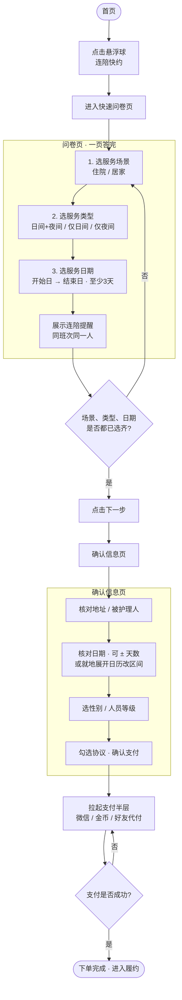
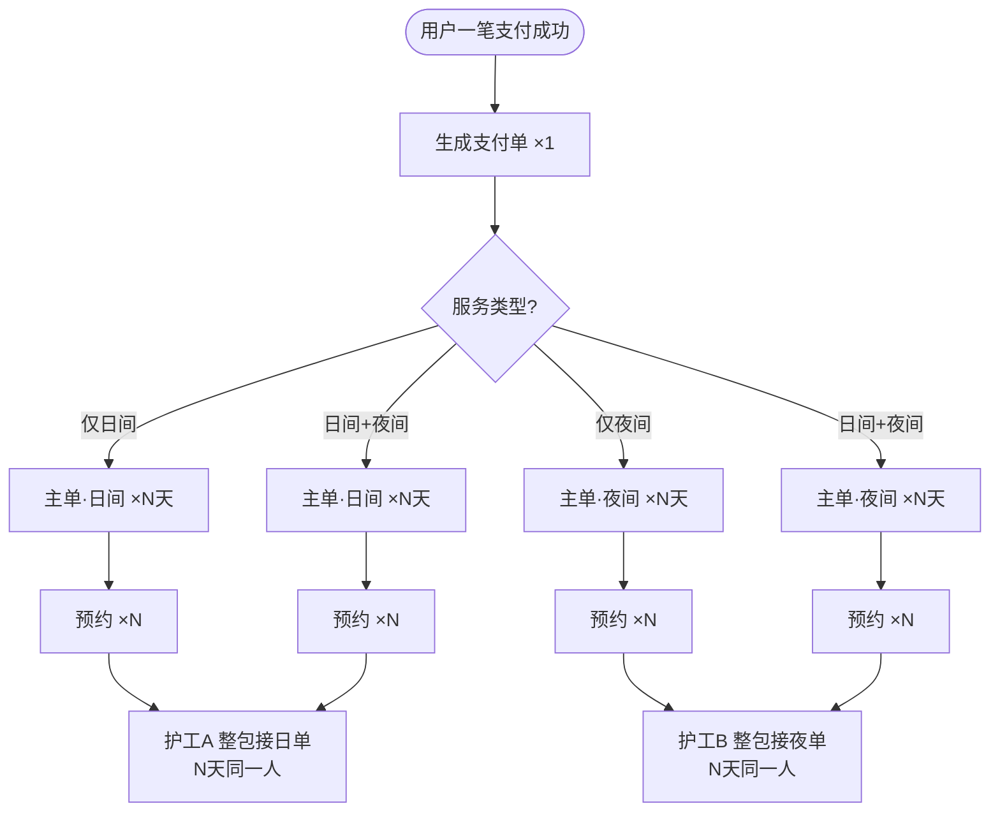

# PRD：快速帮助用户找到服务（连续陪护快下单）

| 属性 | 内容 |
|------|------|
| 需求编号 | R-261022-019 |
| 需求名称 | 快速帮助用户找到服务 |
| 文档版本 | V1.5 |
| 状态 | 方案已冻结（待评审）· 交互原型已对齐 |
| 产品 | e护通小程序（陪护/到家服务） |
| 业务目标 | 让需要连续陪护的人快速下单 |
| 原型 | `index.html`（本地方案切换） |

---

## 1. 背景与问题

### 1.1 现状痛点

1. **24 小时需拆单**：白班 12h + 夜班 12h 要分别下单、分别预约。
2. **连续多天更碎且易换人**：现状抢单按「单次班次」粒度，日间×3 可被最多 3 人各抢 1 天，不保证同一人做满。
3. **难找服务**：用户不易直接找到「连续多日 / 日夜打包」能力。

### 1.2 目标态一句话

用最少步骤完成「连续自然日的日间 / 夜间 / 日间+夜间」下单：**选齐场景/类型/日期 → 一笔支付**；系统生成支付单与班次主单；**一主单一人整包**。例：连续 3 天日间+夜间 → **2 人**（日主单 1 人包 3 天日班，夜主单 1 人包 3 天夜班）。

---

## 2. 目标与成功标准

| 指标 | 方向 |
|------|------|
| 连续 ≥3 天（含日间+夜间）下单步数 / 耗时 | 相对现商详+购物车路径下降 |
| 日主单 / 夜主单「一人履约全部日期」占比 | 上升 |
| 「如何约满 24h / 如何保证同人」类客服咨询 | 下降 |
| 单次仅 12h 路径转化与客诉 | 不恶化 |

---

## 3. 范围

### 3.1 做（MVP）

- **方案一｜首页连陪快约**：首页悬浮球进入，一页问卷选服后确认支付。
- **从服务去下单连陪**：在既有服务确认页改造「上门时间」为连选日期，去掉「先买后约/立即预约」与商品旁数量增减。
- 系统：**1 支付单 → 1～2 主单 → 按日预约**；抢单按主单整包。
- 连续陪护路径 **仅立即预约**（不提供先买后约）。
- 保留现有单次 12h 商详 / 加购 / 先买后约主路径（本需求不替换）。

### 3.2 不做（本迭代）

- 护工端「可见排班页」。
- 用户修改服务钟点；非连续自然日挑选。
- 强制日间与夜间为同一人。
- 全站搜索/分类重构；改造全部旧购物车逻辑。

### 3.3 用户与场景

| 项 | 说明 |
|----|------|
| 目标用户 | 需要连续陪护的下单人（本人或代他人） |
| 场景 | 住院 / 居家 |
| 服务类型 | 日间+夜间陪护 / 仅日间陪护 / 仅夜间陪护 |

---

## 4. 业务规则（已冻结）

### 4.1 日期与时间

| 规则 | 说明 |
|------|------|
| 连续自然日 | 仅支持连续区间（酒店式开始日–结束日） |
| 最少天数 | **至少连续 3 天**；选不足自动扩至 3 天并 Toast；确认页减天数至不足时 Toast「无法再减少」 |
| 最多天数 | 默认最长 **14 天**（可配置） |
| 钟点 | 全国统一配置默认起止；**用户不可改钟点** |
| 默认时段 | 日间+夜间：08:00–次日08:00；仅日间：08:00–20:00；仅夜间：20:00–次日08:00 |

### 4.2 同人规则（连陪提醒）

| 规则 | 说明 |
|------|------|
| 仅日间 × N 天 | N 个日单由 **同一人** 服务 |
| 仅夜间 × N 天 | N 个夜单由 **同一人** 服务 |
| 日间+夜间 × N 天 | **固定 2 人**：日间同一人 + 夜间另一同一人 |
| 交互提示 | 第一页「连陪提醒」随类型展示；确认页不再重复 |

### 4.3 预约与支付

| 规则 | 说明 |
|------|------|
| 预约方式 | 连续陪护 **仅立即预约** |
| 支付 | 用户付 **一笔总价** |
| 单据示例 | 3 天日间+夜间 → **1 支付单 + 2 主单 + 6 预约** |
| 改时间 | 不支持；取消后重下 |

### 4.4 单据生成矩阵

| 用户选择 | 支付单 | 主单 | 预约单 |
|----------|--------|------|--------|
| 仅日间 × N 天 | 1 | 1（日间×N） | N |
| 仅夜间 × N 天 | 1 | 1（夜间×N） | N |
| 日间+夜间 × N 天 | 1 | 2（日间×N + 夜间×N） | 2N |

### 4.5 SKU 映射

| 场景 | 类型 | 映射商品 |
|------|------|----------|
| 居家 | 仅日间 | 居家日间 12 小时看护 |
| 居家 | 仅夜间 | 居家夜间 12 小时看护 |
| 居家 | 日间+夜间 | 上述日间 + 夜间 |
| 住院 | 仅日间 | 住院日间 12 小时陪护 |
| 住院 | 仅夜间 | 住院夜间 12 小时陪护 |
| 住院 | 日间+夜间 | 上述日间 + 夜间 |

---

## 5. 方案与用户流程

### 5.1 方案对照（原型左侧切换）

| 方案 | 入口 | 选服形态 | 确认 / 支付 |
|------|------|----------|-------------|
| **方案一** | 首页悬浮球「连陪快约」 | **一页问卷**：场景 → 类型 → 日期 | 确认页 + 支付半层 |
| **从服务去下单连陪** | 既有服务确认页（商详去下单） | 无独立选服页；在确认页改「上门时间」 | 同页立即支付 |

> 已删除原「同屏选场景/类型/日期」方案；首页入口统一为悬浮球「连陪快约」。

**类型展示顺序：** 日间+夜间陪护 → 仅日间陪护 → 仅夜间陪护。

### 5.2 主流程说明（方案一 · 首页连陪快约）

> 流程图仅绘制**方案一**。从服务去下单见 §5.4 文字，不另附图。

1. 首页点悬浮球「连陪快约」→ 进入快速问卷。
2. **问卷页（一页答完）**：① 场景 → ② 类型 → ③ 连续日期（≥3 天）+ 连陪提醒；未选齐不可下一步。
3. **确认信息页**：地址、被护理人；日期摘要与天数 ±；日/夜商品与偏好；协议后确认支付。改日期在本页展开/收起，不回问卷页。
4. **支付半层** → 一笔支付成功 → 生成单据 → 主单整包抢单。

### 5.3 流程图（方案一 · 首页连陪快约）

#### 图 A：端到端下单（问卷 → 确认 → 支付）



#### 图 B：支付成功后单据与抢单



**读图说明：** 日间+夜间时共 **2 个主单、2 人**；仅日间或仅夜间时共 **1 个主单、1 人**。禁止按天拆抢。

### 5.4 路径补充：从服务去下单连陪（文字，无附图）

适用于已进入某一 12h 服务确认页、需要连续多天时：

| 改造点 | 说明 |
|--------|------|
| 去掉顶部 | **取消**「先买后约 / 立即预约」双卡（本路径默认立即履约） |
| 去掉数量 | **取消**商品旁 ± 数量；天数由上门时间区间决定 |
| 上门时间 | 标签仍为「上门时间」；右侧可点：**未选=「请选择」（品牌色）→ 展开后=「收起」**；选完收起后展示日期区间 |
| 展开区 | 与连陪问卷相同：酒店式开始/结束 + 日历 + 服务天数 ±；最少 3 天 |
| 保留底部 | 协议、合计、立即支付 |

> 从单 SKU 进入时：MVP 按当前商品班次 × 天数出主单；若确认页也要切日间+夜间，另开评审。

### 5.5 异常与边界

| 场景 | 处理 |
|------|------|
| 选区不足 3 天 | 自动扩至最少 3 天并 Toast |
| ± 天数低于 3 | Toast「连续陪护至少3天，无法再减少」，不改日期 |
| 超过最长天数 | 截断至上限并 Toast |
| 改日期未选完就收起 | Toast 提示先选完开始与结束 |
| 主单超时无人整包 | 退款或改期重下（细则运营定） |
| 用户要改钟点 | 明示不支持，取消后重下 |

---

## 6. 功能需求

### 6.1 入口

- **连陪快约**：首页悬浮球（可城市/标签灰度）。
- **从服务去下单**：服务确认页上门时间能力升级（见 §5.4）。
- 可选后续：商详增加文案引导「需要连续多天？」，不替换单次 12h 主 CTA。

### 6.2 连陪快约 · 第一页

| 顺序 | 问题 | 必填 | 说明 |
|------|------|------|------|
| 1 | 住院 / 居家 | 是 | 决定 SKU 池 |
| 2 | 日间+夜间 / 仅日间 / 仅夜间 | 是 | 决定主单数与默认时段 |
| 3 | 连续日期 | 是 | 开始–结束；≥3 天；不可改钟点 |
| — | 连陪提醒 | — | 同人规则说明，随类型变化 |

### 6.3 连陪快约 · 确认页

1. 服务地址、被护理人（可进编辑）。
2. 服务日期摘要 + **服务天数 ±**（日间+夜间文案可为「日夜同步」）；**修改日期**（就地展开/收起日历，文案需单行不换行）。
3. 商品区：按类型展示日/夜 SKU；**无商品旁数量步进器**；性别、人员等级、上门费。
4. 协议 + 合计 + 确认支付 → 支付半层。

### 6.4 从服务去下单 · 确认页

见 §5.4；校验：上门时间已选且 ≥3 天、协议勾选后方可支付。

### 6.5 支付与履约

- 支付成功后创建支付单、主单、预约（事务或可补偿一致）。
- 抢单对象为主单；接单后锁定 `caregiver_id` 并回写该主单下全部预约。
- **禁止**按单日预约抢单、禁止一主单多人拆天数。

### 6.6 订单详情（用户侧）

- 以支付单为头，下挂 1～2 个班次主单；主单下可展开按日预约。
- 状态文案见 §7。

---

## 7. 状态与文案

### 7.1 支付单头

| 状态 | 用户文案 |
|------|----------|
| 待支付 | 待支付 |
| 已支付，存在待接主单 | 已支付，正在安排护工 |
| 日间+夜间一侧已接 | 日间已接单，夜间待接单（或反之） |
| 全部主单已接 | 护工已接单，待上门服务 |
| 服务中 / 已完成 / 已取消 / 退款 | 对应文案 |

### 7.2 主单

| 状态 | 文案要点 |
|------|----------|
| 待接单 | 需同一人服务全部 N 天 |
| 已接单 | 护工 xxx · 将服务 N 天日间/夜间 |

### 7.3 交互 Toast（原型已对齐）

| 场景 | 文案示例 |
|------|----------|
| 不足最少天数（日历） | 连续陪护至少3天，已为你调整至 M/D |
| 再减天数 | 连续陪护至少3天，无法再减少 |
| ± 成功 | 已延长至 / 已缩短至 M/D |
| 未选完收起 | 请先选完开始与结束日期 |

---

## 8. 数据模型

### 8.1 支付单 payment_order

`payment_id, user_id, total/pay_amount, status, scene, service_mode, date_start/end, day_count, address/care_recipient 快照, gender_req, staff_level, book_type=immediate, entry_source(连陪快约|服务确认页), created_at, paid_at`

### 8.2 主单 master_order

`master_order_id, payment_id, shift_type(日间|夜间), sku_id, unit_price, day_count, amount, status, caregiver_id, grab_mode=whole_package, default_time_start/end`

### 8.3 预约单 appointment

`appointment_id, master_order_id, payment_id, service_date, shift_type, time_start/end, status, caregiver_id（=主单锁定人）, seq`

**约束：** 同一主单下全部预约的 `caregiver_id` 必须相同。

### 8.4 关系示例（住院 · 日间+夜间 · 3 天）

```
支付单 ×1
├── 主单·日间（×3天）→ 预约×3 → 护工A 整包
└── 主单·夜间（×3天）→ 预约×3 → 护工B 整包
```

---

## 9. 退改规则（建议默认，待运营确认）

| 场景 | 建议 |
|------|------|
| 整笔未接取消 | 全额退；主单+预约全部取消 |
| 仅一侧主单未接 | 可退该主单金额；已接侧走现有退改 |
| 改钟点 | 不支持 |
| 取消其中一天 | MVP 建议不做，仅整笔退 |

---

## 10. 与旧系统差异

| 维度 | 旧 | 新（连续陪护） |
|------|----|----------------|
| 心智 | 买 12h SKU 自己组 | 选场景+类型+连续日期 / 或确认页连选上门时间 |
| 支付 | 常按商品付 | 一笔总价 |
| 抢单 | 按次拆抢，多天可多人 | 主单整包，3 天日+夜仅 2 人 |
| 先买后约 | 支持 | 连续陪护路径不支持 |
| 数量 | 商品旁 ± | 由日期区间决定；确认页只改结束日 |

---

## 11. 非功能与配置

| 项 | 要求 |
|----|------|
| 默认时段 | 四类 SKU 可配置 |
| 最少 / 最多连续天 | 默认 **3 / 14**，可运营配置 |
| 兼容 | 不影响单次 12h、加购、先买后约 |
| 一致性 | 支付成功与主单/预约创建同事务或可补偿 |

---

## 12. 埋点建议

| 事件 | 用途 |
|------|------|
| 悬浮球曝光/点击 | 入口效率 |
| 从服务确认页展开上门时间 | 路径 B 渗透 |
| 第一页完成/退出、确认页支付成功 | 漏斗 |
| 触发最少天数 Toast 次数 | 规则感知 |
| 主单整包接单成功率 / 耗时 | 履约健康度 |

---

## 13. 开放问题（评审清单）

1. 上门费：按支付单收一次，还是按主单各收一次？（原型暂按支付单一笔上门费）
2. 优惠券：支付单级核销与日/夜分摊、退款规则？
3. 主单超时无人接的时限与自动退？
4. 悬浮球全量还是城市/标签灰度？
5. 从服务去下单：MVP 是否仅支持「当前 SKU 班次 × 天数」，还是确认页也要切日间+夜间？

---

## 14. 研发拆分建议

1. **交易域：** 支付单 ↔ 多主单 ↔ 多预约、金额、支付回调、`entry_source`
2. **履约域：** 主单整包抢单、锁人、状态回写预约
3. **C 端·连陪快约：** 方案一问卷页 + 确认页就地改日期 + 支付半层
4. **C 端·服务确认页：** 去掉先买后约与数量增减；上门时间连选组件
5. **配置：** 默认时段、最少/最多天数、入口开关

---

## 15. 修订记录

| 版本 | 日期 | 说明 |
|------|------|------|
| V1.0 | 2026-10-23 | 首版：基于 BRD 与业务冻结结论整理 |
| V1.1 | 2026-10-23 | 纠正现状/目标抢单模型 |
| V1.2 | 2026-10-23 | 补充业务流程图 |
| V1.3 | 2026-10-26 | 三方案入口与两页下单流程 |
| V1.4 | 2026-10-26 | **对齐终版原型**：悬浮球双方案；废弃条入口；最少 3 天；确认页就地改日期；连陪提醒；新增「从服务去下单连陪」路径（请选择/收起、无先买后约、无商品数量增减） |
| V1.4.1 | 2026-10-26 | 流程图仅保留问卷方案；端到端与单据抢单两图分绘，结构更清晰 |
| V1.5 | 2026-10-26 | 删除同屏方案；**方案一 = 首页连陪快约入口下单**（问卷）；仅保留「从服务去下单连陪」为第二路径 |
